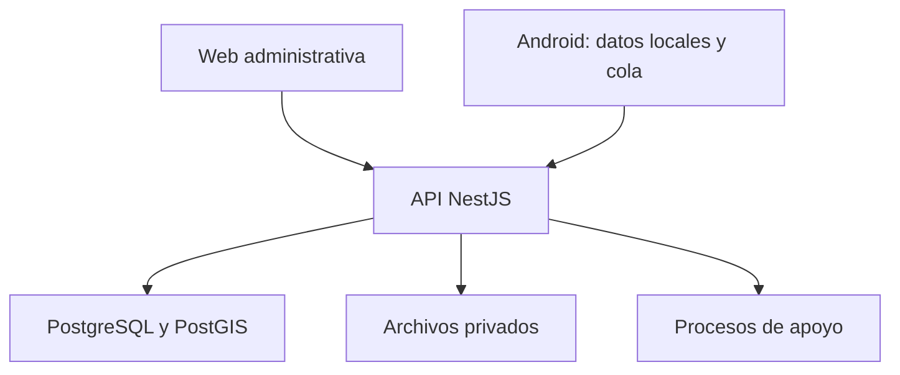

# Tarefero — 04. Arquitectura, integridad y criterios técnicos

**Versión:** 1.0 · **Fecha:** 23 de octubre de 2026  
**Estado:** arquitectura de referencia y requisitos propuestos; no código ejecutado ni configuración de producción.

## Responsabilidad de este archivo

Define cómo preservar el modelo funcional al implementarlo: separación de capas, límites entre módulos, aislamiento de empresas, persistencia, sincronización, seguridad, archivos, reportes y verificación. No reemplaza las especificaciones de cada módulo ni cierra decisiones de infraestructura pendientes.

Los requisitos provienen del proyecto y de los procesos de los archivos 01–03. Este documento no constituye una auditoría de seguridad, una certificación normativa ni una verificación de versiones o precios de proveedores.

## 1. Base tecnológica y grado de decisión

| Componente | Base del proyecto | Estado |
|---|---|---|
| API | NestJS | Confirmado en documento inicial. |
| Arquitectura | Clean Architecture y POO | Confirmado como dirección. |
| Persistencia central | PostgreSQL + PostGIS | Confirmado. |
| ORM | TypeORM | Considerado; validar antes de migraciones. |
| Web | Next.js + TypeScript | Confirmado. |
| Estilo de UI | Tailwind CSS y shadcn/ui | Preferencia de interfaz; confirmar alcance en especificación web. |
| Android | Kotlin + Jetpack Compose | Opción recomendada en documento inicial; registrar adopción final. |
| Persistencia móvil | Room/SQLite | Base propuesta para Android nativo. |
| Reintentos móviles | WorkManager | Base propuesta, sujeta a restricciones reales de Android. |
| Mapas | Mapbox | Confirmado. |
| Infraestructura | Servidor propio con Docker | Confirmado como dirección; topología y operación pendientes. |
| Almacenamiento binario | Almacenamiento de objetos o servicio equivalente | Pendiente. |
| Identidad | JWT y renovación/revocación | Mecanismo concreto y proveedor pendientes. |

No fijar versiones por memoria ni asumir costos o cuotas de servicios. Antes de implementar integraciones, registrar versiones soportadas y verificar documentación oficial vigente.

## 2. Forma de la solución

**Propuesta:** monolito modular para la API inicial, con módulos de dominio bien delimitados y procesos auxiliares cuando sean necesarios. Facilita transacciones, despliegue y mantenimiento para desarrollo principalmente individual. No se exige una arquitectura de microservicios.

La web y Android consumen contratos publicados por la API. La base central no se expone a los clientes. Android conserva un subconjunto autorizado y una cola de operaciones; no es una réplica completa de PostgreSQL.

Mapbox representa mapas e interacción cartográfica; PostGIS conserva la geometría oficial. Un servicio externo no sustituye el historial de negocio almacenado por Tarefero.

## 3. Capas y responsabilidades

| Capa | Contiene | Evita |
|---|---|---|
| Dominio | Entidades, objetos de valor, invariantes y políticas de negocio | Dependencias HTTP, ORM o SDK de mapas. |
| Aplicación | Casos de uso, coordinación, puertos, autorización contextual y límites transaccionales | Lógica de interfaz y consultas indiscriminadas a otras tablas. |
| Infraestructura | ORM, repositorios, PostgreSQL/PostGIS, almacenamiento, identidad e integraciones | Convertirse en la única ubicación de reglas del negocio. |
| Presentación | Controllers, DTOs, validación de entrada y traducción de errores | Calcular stock, dinero o remuneración dentro del controlador. |

### 3.1 Entidad de dominio y entidad de persistencia

La entidad de dominio define significado y comportamiento. El mapeo ORM define columnas, relaciones e índices físicos. Pueden tener estructuras diferentes por razones de almacenamiento. No deben convertirse en dos fuentes contradictorias de reglas.

El archivo 02 es el contrato lógico inicial. Cada especificación de módulo decide qué campos son de dominio, cuáles son derivados y cuáles son técnicos. Los DTOs exponen únicamente lo necesario para cada operación, sin devolver automáticamente toda la entidad ORM.

### 3.2 POO y composición

Un lote no necesita una subclase por cultivo. Una implantación referencia un cultivo y un perfil. Las estrategias de cálculo o políticas especializadas se introducen cuando cambia un comportamiento real, no para representar una etiqueta diferente.

Objetos de valor candidatos: dinero con moneda, cantidad con unidad, rango de fechas, superficie, identificador de empresa y contexto de ubicación. Su implementación debe aportar validación y claridad; no exigir una clase por cada campo simple.

### 3.3 Módulos NestJS

Un módulo funcional reúne controllers, casos de uso y adaptadores de su responsabilidad. Su `@Module()` declara imports, providers, controllers y exports. No se necesita un módulo por tabla.

## 4. Límites entre módulos

| Módulo | Es dueño de | Dependencias permitidas |
|---|---|---|
| Identidad y acceso | Usuarios, membresías, roles y sesiones | Plataforma y proveedores de identidad. |
| Territorio | Chacras, lotes y geometrías | Empresa y autorización. |
| Producción agrícola | Cultivos, implantaciones, ciclos y perfiles | Territorio y catálogos. |
| Personal | Empleados, cuadrillas, asistencia y tarifas | Empresa y acceso. |
| Labores | Órdenes, ejecución y participaciones | Contexto agrícola, personal e inventario mediante contratos. |
| Inventario | Artículos, partidas, ubicaciones y movimientos | Fuentes de operaciones validadas. |
| Compras | Proveedores, compras y recepciones | Terceros, inventario y economía mediante casos de uso. |
| Observaciones | Registro y detalles de seguimiento | Implantaciones, perfiles y archivos. |
| Cosechas y entregas | Producción, pesajes y expedición | Contexto agrícola, inventario, labores y terceros. |
| Economía | Obligaciones, dinero, imputaciones y costos | Documentos fuente; no los reescribe. |
| Archivos | Binarios, metadatos y acceso | Permisos del módulo propietario. |
| Sincronización | Comandos, idempotencia y descarga | Invoca casos de uso existentes. |
| Reportes | Consultas y proyecciones | Lectura autorizada de datos consistentes. |

Un controlador de cosecha no inserta directamente movimientos en tablas de inventario sin ejecutar sus reglas. El módulo de sincronización tampoco crea una segunda implementación del negocio: usa los mismos casos de uso que la web.

## 5. Transacciones y efectos

### 5.1 Unidades atómicas mínimas

- Recepción confirmada + líneas + entradas de stock.
- Despacho de transferencia + salida de origen + entrada a tránsito.
- Recepción de transferencia + salida de tránsito + entrada de destino.
- Consumo confirmado + salida + costo aplicado cuando corresponda.
- Cosecha almacenada confirmada + partidas + entradas.
- Entrega despachada + salidas físicas o asignaciones de entrega directa.
- Pago/cobro confirmado + registro monetario + imputaciones incluidas en ese comando.
- Transición + historial funcional + resultado de idempotencia.

Si se confirman efectos por línea, esa granularidad debe ser explícita en estados y respuesta. No responder éxito total cuando existen efectos fallidos ocultos.

### 5.2 Operaciones externas

Subir un archivo no comparte transacción con PostgreSQL. Usar estados pendientes, finalización y reconciliación. No dejar transacciones de base abiertas mientras se espera una transferencia de red.

Los trabajos asíncronos, como informes pesados o miniaturas, deben ser reintentables. Si se publica un evento después de una transacción importante, usar un patrón de entrega durable como outbox cuando sea necesario para no perder efectos; no exigir event sourcing para todo el producto.

## 6. Persistencia e integridad

### 6.1 Aislamiento multiempresa

1. El servidor obtiene empresa del contexto autenticado y membresía autorizada.
2. Cada consulta y comando aplica ese contexto.
3. Cada referencia de negocio verifica pertenencia a la misma empresa.
4. Restricciones compuestas `(company_id, id)` y FK compuestas son una defensa candidata donde sean aplicables.
5. Catálogos globales son excepciones de lectura definidas y probadas.
6. Evaluar RLS como defensa adicional; no sustituye autorización ni un contexto correctamente administrado.
7. Archivos, exportaciones, colas y procesos de fondo aplican el mismo aislamiento.

Un ID válido no demuestra permiso. Conocer la URL o el UUID de un archivo no habilita descargarlo.

### 6.2 Restricciones

- Unicidad de códigos dentro de empresa o chacra, según diccionario.
- Unicidad de claves idempotentes y de efectos por línea/documento.
- Restricciones de cantidades, signos, monedas y fechas.
- FK para relaciones centrales y validación de vínculos de navegación técnica.
- Impedir eliminación física de referencias históricas.
- Tratar `NULL` y cero con significados distintos.
- No aceptar estados que el caso de uso no puede producir.

Las reglas que abarcan varias filas —stock disponible, suma de imputaciones, cantidad entregable— requieren control transaccional además de validaciones simples.

### 6.3 Concurrencia

Maestros y documentos editables usan versión optimista. Para saldos físicos, disponibilidad de producción e imputaciones monetarias, usar bloqueos o estrategia equivalente que asegure límites bajo concurrencia.

Dos consumos simultáneos no pueden confirmar usando ambos el mismo saldo inicial si el resultado viola la política de stock. Dos pagos no deben cancelar dos veces la misma obligación por haber leído simultáneamente el mismo pendiente.

### 6.4 Índices candidatos

| Consulta | Índice orientativo a validar |
|---|---|
| Listado tenant por fecha | company_id + fecha + id. |
| Historial de implantación | company_id + lot_planting_id + fecha. |
| Movimientos de artículo/almacén | company_id + warehouse_id + product_id + product_batch_id + occurred_at. |
| Búsqueda de códigos | Unicidad por ámbito correspondiente. |
| Geometrías | Índice espacial apropiado, por ejemplo GiST. |
| Reintento de comando | company_id + client_operation_id único. |
| Pendientes y estados | Índice según selectividad y patrones reales. |

Son candidatos, no instrucciones de crear todos. Medir consultas y planes con volumen representativo.

### 6.5 Cantidades, costos y redondeo

Usar decimal/numeric en cantidades exactas e importes. Definir precisión por magnitud, regla de redondeo monetario y momento de aplicación. Los snapshots de tarifa, conversión y costo permiten explicar el pasado.

El método de valuación de inventario es pendiente. Debe elegirse antes de informar costos definitivos de consumos. Hasta entonces, mostrar costo estimado o no valorizado. Cambiar método no reescribe silenciosamente operaciones anteriores.

## 7. API y contratos

### 7.1 Contratos explícitos

- DTOs por acción: crear, editar borrador, presentar, confirmar, anular, despachar y recibir.
- Validación de formato, rangos, campos desconocidos y límites de tamaño.
- Validación de negocio posterior dentro del caso de uso.
- Respuestas que indican identidad, versión, estado y efectos relevantes.
- Contratos OpenAPI o equivalentes como fuente de intercambio web/móvil.
- Tipos TypeScript y modelos Kotlin pueden generarse o alinearse con el contrato; compartir contrato no significa ejecutar las mismas clases en ambos lenguajes.

### 7.2 Paginación

Todo listado debe tener paginación y orden estable. La consulta aplica filtros y límites en base de datos; no descargar todo para recortar en memoria.

Metadatos candidatos: `items`, `limit`, `offset`, `total` y, si corresponde, `has_more`. Para descarga incremental o volúmenes grandes, usar cursor y metadatos equivalentes. El conteo total puede ser costoso; acordar qué endpoints lo requieren. Exportaciones completas se implementan como proceso explícito, no eludiendo límites de un listado.

### 7.3 Errores

Formato estable con código, mensaje comprensible, errores de campo, identificador de correlación y detalles corregibles permitidos. No exponer SQL, stack traces, secretos o datos de otra empresa.

Distinguir: acceso no permitido, validación inválida, conflicto de versión, saldo insuficiente, estado incompatible y error transitorio. El móvil necesita saber qué puede reintentar y qué requiere intervención.

### 7.4 Acciones e idempotencia

Confirmaciones y comandos móviles llevan identidad de operación. Reutilizar la clave con contenido distinto produce conflicto. Las acciones sensibles expresan intención de negocio; editar un JSON completo del recurso no reemplaza un comando de despacho o pago.

## 8. Seguridad de aplicación

- Autenticación valida firma y claims pertinentes; un JWT firmado no está necesariamente cifrado.
- Autorización verifica membresía activa, permisos y alcance; la estrategia de consulta/cache y revocación queda definida en la especificación de identidad.
- En NestJS, guards son el lugar natural propuesto para control de acceso de rutas; no concentrar toda la autorización en un interceptor de transformación de respuestas.
- Credenciales protegidas, renovación y revocación con política explícita.
- Transporte cifrado y protección de secretos del servidor.
- Política de sesión web y almacenamiento móvil seguro antes del piloto.
- Límites de solicitudes y archivos con tratamiento coherente detrás de proxies.
- Registro de acciones críticas y acceso restringido a información personal/salarial.
- Descargas privadas con autorización y, si se usan URLs temporales, vencimiento acotado.
- No enviar a Android campos de empleados o economía que el usuario no necesita.

No se cierra aquí el algoritmo de firma, duración exacta de tokens, proveedor de identidad ni diseño de renovación. Deben registrarse con criterios operativos y amenazas reales antes de implementar.

## 9. Arquitectura Android offline

### 9.1 Datos locales

Room conserva maestros autorizados, registros editables, estados, cola y metadatos de adjuntos. Los archivos se guardan en almacenamiento privado de aplicación según política. Aislar datos por empresa y usuario; cambiar contexto no mezcla pendientes.

La UI lee la base local y refleja las confirmaciones centrales. El repositorio móvil coordina persistencia y red. La validación local mejora la captura, pero el backend aplica las reglas definitivas.

### 9.2 Subida de comandos

Cada edición relevante produce un comando durable con nueva identidad. El envío respeta dependencias: una cosecha nueva no debe referenciar una implantación que el servidor todavía desconoce, salvo creación coordinada explícita.

WorkManager coordina trabajo y reintentos dentro de las restricciones de Android. No prometer sincronización inmediata ni ejecución garantizada a una hora exacta. Mostrar estado y permitir reintento manual cuando sea útil.

### 9.3 Descarga incremental

Usar cursor central estable por feed autorizado, versión de entidad y retiros. Aplicar páginas de forma atómica antes de avanzar cursor. Una baja de catálogo no borra referencias históricas locales. Un cambio de permiso exige una política de retiro de copias locales compatible con trabajo pendiente.

### 9.4 Resolución por tipo

| Tipo | Política inicial propuesta |
|---|---|
| Catálogos | Servidor publica; dispositivo conserva versiones necesarias. |
| Borradores editados en dos lugares | Conflicto por versión con elección o combinación explícita. |
| Observaciones nuevas | Identidad propia y deduplicación de comandos. |
| Stock | Declaración local y confirmación central con saldo. |
| Cosechas | Validación central de origen, cantidades y asignaciones. |
| Pagos | Inicialmente web; no habilitar offline sin diseño adicional. |
| Adjuntos | Cola separada con integridad y reintento. |

### 9.5 Acceso sin conexión

Una revocación central no se conoce inmediatamente en un dispositivo desconectado. Definir ventana de operación, reautenticación, operaciones habilitadas, protección local y tratamiento de comandos capturados antes/después de la revocación. No prometer bloqueo instantáneo offline.

## 10. Configuración por cultivo

### 10.1 Publicación

Un perfil tiene borradores y versiones publicadas. Publicar valida referencias, tipos, unidades y compatibilidad de formularios. Una versión usada no se modifica en el lugar. El dispositivo descarga versiones pertinentes.

### 10.2 Límites

Configurables: etiquetas, ayudas, catálogos permitidos, atributos complementarios y requisitos dentro de formularios implementados.

No configurables libremente: pertenencia de empresa, permisos, generación de stock, firma de documentos, integridad monetaria, código ejecutable ni transiciones con efectos desconocidos.

### 10.3 Historial

Un registro conserva versión interpretativa y valores usados. Desactivar un campo deja de ofrecerlo a futuro, pero permite leer el pasado. Si un atributo se vuelve central para filtros o cálculos, migrarlo a estructura explícita mediante cambio versionado y conversión documentada.

## 11. Geometrías y mapas

- Almacenar SRID explícito y tipo geométrico acordado.
- Validar geometrías vacías, degeneradas, autointersecciones y otras invalideces.
- Calcular área mediante geodesia o proyección apropiada, no diferencias en grados.
- Definir reglas de solapamiento por lote y sector según operación real.
- Conservar versiones importantes o superficies históricas aplicadas.
- Distinguir visualización del mapa y disponibilidad offline de mapas: el segundo alcance requiere revisión de integración, licencias y capacidades antes de prometerlo.

La app puede registrar labores sin mapa descargado si tiene referencias locales de lotes. La continuidad operativa no debe depender de dibujar un polígono en cada visita.

## 12. Archivos

1. Solicitar carga con identidad de empresa y entidad destino autorizada.
2. Validar tipo real, extensión permitida y tamaño.
3. Crear metadatos en estado pendiente.
4. Transferir binario con mecanismo privado.
5. Verificar integridad y finalizar disponibilidad.
6. Vincular mediante relación explícita del módulo.
7. Resolver cargas abandonadas sin borrar archivos válidos.

Definir tipos admitidos —por ejemplo imagen y PDF— y límites antes de la primera entrega. Evaluar análisis de contenido malicioso según exposición. La eliminación de evidencia usada en un hecho confirmado requiere política de retención y permisos; no tratarla como borrado libre de un archivo sin contexto.

## 13. Reportes y proyecciones

Listados operativos consultan datos transaccionales con filtros e índices. Informes pesados pueden usar proyecciones o resúmenes reconstruibles. Cada indicador documenta fuente, alcance, fecha, unidad, moneda y tratamiento de anulaciones.

Un saldo materializado o una proyección de obligaciones no constituye otra fuente independiente editable. Debe existir una forma de reconciliarlo con movimientos y documentos.

Los informes que mezclen monedas necesitan conversión explícita con tipo de cambio, fecha y regla. Hasta definirlo, agrupar por moneda y evitar totales falsos.

## 14. Infraestructura y operación

Docker es la base de despliegue prevista; la topología exacta se define después. Como mínimo, separar configuración, datos persistentes, binarios y secretos. Mantener migraciones versionadas y un procedimiento de despliegue repetible.

### 14.1 Backups

Respaldar base y archivos con una estrategia consistente. Definir RPO —pérdida máxima de datos aceptable— y RTO —tiempo objetivo de recuperación— con el usuario antes del piloto. Probar restauración; tener archivos de backup sin verificar no demuestra recuperabilidad.

### 14.2 Observabilidad

Métricas mínimas: fallos de API, comandos rechazados/en conflicto, tiempos de sincronización, cargas pendientes, transacciones fallidas, stock inconsistente y trabajos de fondo. Logs con correlación y sin secretos. Una falla técnica debe poder rastrearse hasta el comando sin exponer información de otras empresas.

### 14.3 Migraciones

Los cambios de esquema y perfiles se planifican junto con compatibilidad de versiones móviles. Un dispositivo puede pasar días sin actualizar. Definir una ventana de compatibilidad y mensajes de actualización; no asumir que todos actualizan al desplegar backend.

## 15. Estrategia de implementación con SDD

Este conjunto es una base de análisis, no todos los archivos de especificación de cada módulo. Mantener la estructura documental existente del proyecto cuando se incorpore.

Por módulo:

1. Delimitar problema, actores, alcance y dependencias.
2. Convertir entidades candidatas en campos y reglas aprobados.
3. Especificar casos de uso, estados y efectos.
4. Definir contratos, errores, permisos y capturas offline.
5. Definir persistencia, restricciones y migraciones.
6. Implementar un circuito vertical completo.
7. Verificar criterios de aceptación y actualizar documentación con comportamiento real.
8. Registrar decisiones pendientes y cambios de alcance.

El archivo principal de instrucciones de IA del repositorio debe señalar las fuentes de verdad y el orden de lectura. Este conjunto no crea ni sustituye un AGENTS.md existente.

### 15.1 Fuente de verdad por responsabilidad

| Pregunta | Fuente |
|---|---|
| ¿Debe existir la capacidad? | Alcance y decisión funcional. |
| ¿Qué significa el dato? | Modelo de dominio y especificación del módulo. |
| ¿Cómo se comporta? | Casos de uso y reglas del módulo. |
| ¿Cómo se intercambia? | Contrato de API versionado. |
| ¿Cómo se guarda? | Mapeo y migraciones coherentes con el dominio. |
| ¿Qué está implementado? | Código, validaciones y comprobación contra la especificación. |

## 16. Verificación necesaria

| Área | Evidencia esperada |
|---|---|
| Dominio | Reglas de cantidades, contexto, fechas, tarifas y transiciones. |
| Integración | Efectos transaccionales completos o rollback. |
| Aislamiento | Acceso cruzado denegado en listados, IDs, archivos y sincronización. |
| Concurrencia | Consumos e imputaciones simultáneos no exceden disponibilidad. |
| Idempotencia | Reintentos no duplican movimientos, cosechas ni pagos. |
| Offline | Cierre de app, pérdida de respuesta, dependencias y conflictos conservan datos. |
| Historial | Cambios de tarifa, perfil, cultivo y superficie no reescriben el pasado. |
| Reportes | Anulaciones, compensaciones y proyecciones no duplican ni omiten efectos. |
| Operación | Restauración probada y migraciones controladas. |

Las pruebas deben demostrar riesgos reales. No se exige escribir tests triviales que solo repitan declaraciones. Este paquete documental no afirma que estas pruebas hayan sido ejecutadas sobre un sistema implementado.

## 17. Matriz mínima de trazabilidad por módulo

| Módulo | Origen que conserva | Efecto que enlaza | Corrección |
|---|---|---|---|
| Implantación | Lote, cultivo y vigencia | Eventos, ciclos y operaciones | Evento o nueva implantación. |
| Asistencia | Empleado y día | Intervalos y comparación laboral | Versión y motivo. |
| Labor | Tipo y contexto | Participaciones, consumos y costos | Corrección con dependencias. |
| Recepción | Compra y línea | Entradas y partidas | Reversión/devolución. |
| Transferencia | Ubicación y línea | Tránsito y recepciones | Resolución de diferencia. |
| Cosecha | Implantación y ciclo | Producción, partidas y ruta | Corrección con efectos resueltos. |
| Entrega | Líneas productivas | Salida, recepción e ingreso | Retorno/compensación especificados. |
| Economía | Documento y contraparte | Obligación, movimiento e imputación | Ajuste o reversión. |
| Archivo | Autor y entidad | Evidencia accesible | Retiro según política. |

## 18. Definición de terminado de un módulo

Un módulo está listo cuando su responsabilidad, campos, permisos, estados, errores y dependencias están especificados; sus efectos centrales preservan integridad; sus datos son trazables; soporta reintentos y conflictos si admite campo; sus listados están paginados; sus operaciones respetan empresa; y sus criterios de aceptación relevantes están verificados.

No basta con tener pantallas CRUD. El módulo debe cerrar el circuito que promete al usuario, incluidos casos parciales y correcciones, o declarar explícitamente qué variante aún no está habilitada.

## 19. Pendientes técnicos a resolver antes del piloto

- Autenticación, firma, renovación, revocación y sesión web/móvil.
- ORM definitivo y política de transacciones/bloqueos.
- Método de valuación de inventario y precisión por magnitud.
- Modelo exacto de campañas/ciclos y solapamientos.
- Confirmación atómica o por línea para recursos de labor.
- Política de stock negativo y excepciones autorizadas.
- Ventana offline y compatibilidad de versiones de app.
- Proveedor de archivos, retención, límites y control de descarga.
- Despliegue, monitoreo, backups, RPO y RTO.
- Alcance cartográfico offline y revisión de integración Mapbox.
- Requisitos particulares de aplicaciones de insumos y de información laboral, cuando se habiliten esos procesos.

Cada pendiente debe convertirse en una decisión concreta y registrada antes de implementar la parte que depende de él.
