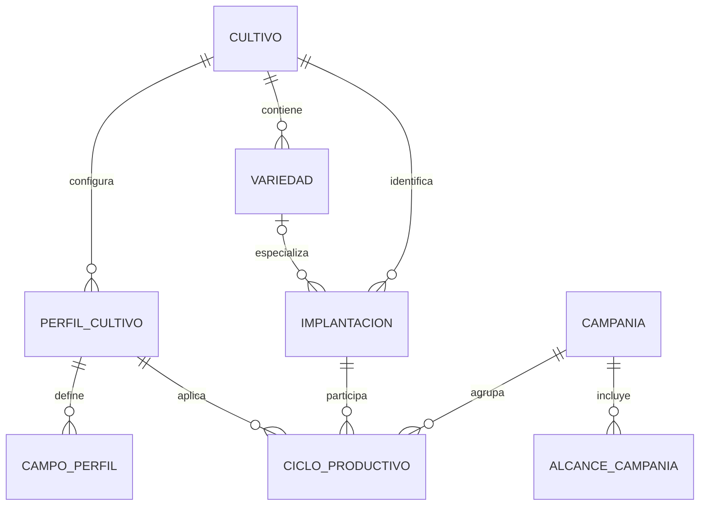

# Contexto productivo — Modelo de datos

## 1. Diagrama

## 2. Entidades

### CUL-ENT-001 — Cultivo
- **Estado:** Aprobado
- **Descripción:** identidad global de aquello que se produce.
- **Identidad:** Identificador según convenciones.md §2.

| Atributo | Tipo | Requerido | Restricción | Origen |
|---|---|:---:|---|---|
| `id` | Identificador | Sí | Convenciones §2 | Convenciones |
| `codigo` | Texto | Sí | 1 a 50, mayúsculas, estable y único; `CUL-BR-001` | IA, `CUL-Q-022` |
| `nombre` | Texto | Sí | 1 a 150, elimina espacios exteriores, único normalizado; `CUL-BR-001` | IA, `CUL-Q-022` |
| `descripcion` | Texto | No | Máximo 1000, elimina espacios exteriores | IA, `CUL-Q-022` |
| `estado` | Enumeración | Sí | `ACTIVO`, `INACTIVO`; `CUL-BR-022` | `CUL-Q-015`, `CUL-Q-022` |

**Relaciones:** tiene muchas `CUL-ENT-002`, `CUL-ENT-003` y `CUL-ENT-005`.

### CUL-ENT-002 — Variedad
- **Estado:** Aprobado
- **Descripción:** variante identificada de un Cultivo.
- **Identidad:** Identificador según convenciones.md §2.

| Atributo | Tipo | Requerido | Restricción | Origen |
|---|---|:---:|---|---|
| `id` | Identificador | Sí | Convenciones §2 | Convenciones |
| `cultivoId` | Referencia `CUL-ENT-001` | Sí | `CUL-BR-002` | `CUL-Q-001` |
| `codigo` | Texto | Sí | 1 a 50, mayúsculas y único por Cultivo | IA, `CUL-Q-022` |
| `nombre` | Texto | Sí | 1 a 150, único normalizado por Cultivo | IA, `CUL-Q-022` |
| `descripcion` | Texto | No | Máximo 1000, elimina espacios exteriores | IA, `CUL-Q-022` |
| `estado` | Enumeración | Sí | `ACTIVA`, `INACTIVA`; `CUL-BR-022` | `CUL-Q-015`, `CUL-Q-022` |

### CUL-ENT-003 — Perfil de cultivo
- **Estado:** Aprobado
- **Descripción:** versión de configuración aplicable a un Cultivo y alcance.
- **Identidad:** Identificador según convenciones.md §2.

| Atributo | Tipo | Requerido | Restricción | Origen |
|---|---|:---:|---|---|
| `id` | Identificador | Sí | Convenciones §2 | Convenciones |
| `cultivoId` | Referencia `CUL-ENT-001` | Sí | Cultivo activo o histórico | `B-05`, `CUL-Q-006` |
| `alcance` | Enumeración | Sí | `BASE`, `EMPRESA`, `LOTE` | `CUL-Q-006` |
| `empresaId` | Referencia externa | Cond. | Requerida para EMPRESA o LOTE; `CUL-DEP-001` | `CUL-Q-006` |
| `loteId` | Referencia externa | Cond. | Requerida para LOTE; `CUL-DEP-002` | `CUL-Q-006` |
| `perfilPadreId` | Referencia `CUL-ENT-003` | No | Base de precedencia; `CUL-BR-004` | `CUL-Q-006` |
| `nombre` | Texto | Sí | 1 a 150, elimina espacios exteriores | IA, `CUL-Q-022` |
| `descripcion` | Texto | No | Máximo 1000 | IA, `CUL-Q-022` |
| `version` | Entero | Sí | Mayor que cero; única por línea de Perfil | IA, `CUL-Q-022` |
| `estado` | Enumeración | Sí | `BORRADOR`, `PUBLICADO`, `INACTIVO`; `CUL-BR-006` | IA, `CUL-Q-022` |

Una versión PUBLICADA es inmutable y puede ser referenciada por muchos Ciclos. La resolución sigue `CUL-BR-004`.

### CUL-ENT-004 — Campo de Perfil
- **Estado:** Aprobado
- **Descripción:** definición tipada de un dato solicitado por el Perfil.
- **Identidad:** Identificador según convenciones.md §2.

| Atributo | Tipo | Requerido | Restricción | Origen |
|---|---|:---:|---|---|
| `id` | Identificador | Sí | Convenciones §2 | Convenciones |
| `perfilId` | Referencia `CUL-ENT-003` | Sí | Versión dueña | `CUL-Q-019` |
| `codigo` | Texto | Sí | 1 a 100, mayúsculas y estable dentro del Perfil | `CUL-Q-019`; límite IA |
| `nombre` | Texto | Sí | 1 a 150 | `CUL-Q-019`; límite IA |
| `descripcion` | Texto | No | Máximo 1000 | `CUL-Q-019`; límite IA |
| `destino` | Enumeración | Sí | `IMPLANTACION`, `CICLO`, `LABOR`, `OBSERVACION`, `COSECHA` | `CUL-Q-008`, `CUL-Q-019` |
| `tipo` | Enumeración | Sí | `TEXTO`, `ENTERO`, `DECIMAL`, `BOOLEANO`, `FECHA`, `SELECCION` | `CUL-Q-019` |
| `obligatorio` | Booleano | Sí | No desactiva base obligatorio; `CUL-BR-004` | `CUL-Q-006` |
| `unidadId` | Referencia externa | Cond. | Requerida para Decimal cuando corresponda; `CUL-DEP-008` | `CUL-Q-019` |
| `validaciones` | Configuración tipada | No | Longitud, rango o valores; sin código ejecutable | `CUL-Q-019` |

### CUL-ENT-005 — Implantación
- **Estado:** Aprobado
- **Descripción:** establecimiento histórico de un Cultivo en un Lote o sector.
- **Identidad:** Identificador según convenciones.md §2.

| Atributo | Tipo | Requerido | Restricción | Origen |
|---|---|:---:|---|---|
| `id` | Identificador | Sí | Convenciones §2 | Convenciones |
| `empresaId` | Referencia externa | Sí | `CUL-DEP-001` | `CUL-Q-016` |
| `loteId` | Referencia externa | Sí | Lote ACTIVO; `CUL-DEP-002`, `CUL-BR-008` | `B-01`, `CUL-Q-016` |
| `cultivoId` | Referencia `CUL-ENT-001` | Sí | `CUL-BR-003`, `CUL-BR-008` | `B-01` |
| `variedadId` | Referencia `CUL-ENT-002` | No | Compatible; `CUL-BR-002` | `CUL-Q-016` |
| `fechaInicio` | Fecha civil | Sí | `CUL-BR-008` | `CUL-Q-016` |
| `fechaFinalizacion` | Fecha civil | No | No anterior al inicio; `CUL-BR-010` | `CUL-Q-016` |
| `superficie` | Decimal (hectáreas) | Sí | Positiva, precisión a definir al planificar; `CUL-BR-009` | `CUL-Q-016` |
| `sector` | Texto | No | Máximo 150, identifica superficie diferenciable | `CUL-Q-016`; límite IA |
| `estado` | Enumeración | Sí | `ACTIVA`, `FINALIZADA` | IA, `CUL-Q-022` |

**Estados**

| Desde | Hacia | Por | Regla |
|---|---|---|---|
| No existe | `ACTIVA` | `CUL-UC-003` | `CUL-BR-008`, `CUL-BR-009` |
| `ACTIVA` | `FINALIZADA` | `CUL-UC-004` | `CUL-BR-010` |

### CUL-ENT-006 — Campaña
- **Estado:** Aprobado
- **Descripción:** período de gestión productiva de una Empresa cliente.
- **Identidad:** Identificador según convenciones.md §2.

| Atributo | Tipo | Requerido | Restricción | Origen |
|---|---|:---:|---|---|
| `id` | Identificador | Sí | Convenciones §2 | Convenciones |
| `empresaId` | Referencia externa | Sí | `CUL-DEP-001`, `CUL-BR-011` | `CUL-Q-002` |
| `nombre` | Texto | Sí | 1 a 150, no único; `CUL-BR-020` | `CUL-Q-017` |
| `descripcion` | Texto | No | Máximo 1000; `CUL-BR-020` | `CUL-Q-017` |
| `fechaInicio` | Fecha civil | Sí | `CUL-BR-020` | `CUL-Q-017` |
| `fechaFinalizacionTentativa` | Fecha civil | Sí | Posterior o igual al inicio; queda fijada al activar; `CUL-BR-020` | `B-10`, `B-11`, `CUL-Q-021` |
| `fechaFinalizacion` | Fecha civil | No | Fecha real requerida al cerrar; `CUL-BR-017` | `B-10`, `B-11`, `CUL-Q-020`, `CUL-Q-021` |
| `estado` | Enumeración | Sí | `BORRADOR`, `ACTIVA`, `CERRADA` | `CUL-Q-005` |

Las fechas de Campaña describen su período integral desde la preparación del suelo hasta la finalización declarada. Las Cosechas conservan además fechas propias e independientes mediante `CUL-DEP-006`.

**Estados**

| Desde | Hacia | Por | Regla |
|---|---|---|---|
| No existe | `BORRADOR` | `CUL-UC-005` | `CUL-BR-020` |
| `BORRADOR` | `ACTIVA` | `CUL-UC-006` | `CUL-BR-014` |
| `ACTIVA` | `CERRADA` | `CUL-UC-009` | `CUL-BR-017` |
| `CERRADA` | `ACTIVA` | `CUL-UC-009` | `CUL-BR-014`, `CUL-BR-018` |

### CUL-ENT-007 — Alcance de Campaña
- **Estado:** Aprobado
- **Descripción:** membresía histórica de Chacras y Lotes en una Campaña.
- **Identidad:** Identificador según convenciones.md §2.

| Atributo | Tipo | Requerido | Restricción | Origen |
|---|---|:---:|---|---|
| `id` | Identificador | Sí | Convenciones §2 | Convenciones |
| `campaniaId` | Referencia `CUL-ENT-006` | Sí | `CUL-BR-011` | `CUL-Q-002` |
| `chacraId` | Referencia externa | No | Fuente de inclusión; `CUL-DEP-002` | `CUL-Q-002` |
| `loteId` | Referencia externa | Sí | Lote incluido de forma explícita o por Chacra | `CUL-Q-002`, `CUL-Q-014` |
| `origen` | Enumeración | Sí | `CHACRA`, `LOTE_EXPLICITO`, `AMPLIACION` | `CUL-Q-002`, `CUL-Q-014` |
| `incorporadoEn` | FechaHora | Sí | UTC | `CUL-Q-014` |
| `incorporadoPor` | Referencia de actor | Sí | Auditoría | `CUL-Q-014` |

No se elimina de una Campaña ACTIVA: `CUL-BR-013`.

### CUL-ENT-008 — Ciclo productivo
- **Estado:** Aprobado
- **Descripción:** participación productiva de una Implantación dentro de una Campaña.
- **Identidad:** Identificador según convenciones.md §2.

| Atributo | Tipo | Requerido | Restricción | Origen |
|---|---|:---:|---|---|
| `id` | Identificador | Sí | Convenciones §2 | Convenciones |
| `campaniaId` | Referencia `CUL-ENT-006` | Sí | `CUL-BR-015` | `CUL-Q-002` |
| `implantacionId` | Referencia `CUL-ENT-005` | Sí | Única por Campaña; `CUL-BR-015` | `CUL-Q-001`, `CUL-Q-011` |
| `perfilId` | Referencia `CUL-ENT-003` | Sí | Versión PUBLICADA y bloqueada; `CUL-BR-007` | `CUL-Q-013` |
| `estado` | Enumeración | Sí | `BORRADOR`, `ACTIVO`, `FINALIZADO` | IA, `CUL-Q-022` |

**Estados**

| Desde | Hacia | Por | Regla |
|---|---|---|---|
| No existe | `BORRADOR` | `CUL-UC-005` | `CUL-BR-007` |
| `BORRADOR` | `ACTIVO` | `CUL-UC-006`, `CUL-UC-007` | `CUL-BR-021` |
| `ACTIVO` | `FINALIZADO` | `CUL-UC-008` | `CUL-BR-021` |

## 3. Datos de otros módulos

| Dato | Módulo dueño | Cómo se usa | Dependencia |
|---|---|---|---|
| Empresa cliente | EMP | Pertenencia y vigencia | `CUL-DEP-001` |
| Chacra, Lote y superficie | TER | Alcance e Implantaciones | `CUL-DEP-002` |
| Actor y permisos | ACC | Autorización | `CUL-DEP-003` |
| Labores | LAB | Hechos referenciados | `CUL-DEP-004` |
| Observaciones | OBS | Hechos referenciados | `CUL-DEP-005` |
| Cosechas y sus fechas | COS | Producción referenciada | `CUL-DEP-006` |
| Indicadores | REP | Proyecciones por contexto | `CUL-DEP-007` |
| Unidades | INV | Campos Decimales | `CUL-DEP-008` |

## 4. Índices y restricciones necesarias

| Necesidad | Motivo | Migración |
|---|---|---|
| Código y nombre normalizados únicos de Cultivo | `CUL-BR-001` | Pendiente de planificación |
| Código y nombre de Variedad únicos por Cultivo | `CUL-BR-002` | Pendiente de planificación |
| Versión única por línea de Perfil | `CUL-BR-006` | Pendiente de planificación |
| Ciclo único por Campaña e Implantación | `CUL-BR-015` | Pendiente de planificación |
| Lote único dentro del alcance de Campaña | `CUL-BR-011` | Pendiente de planificación |
| Consulta de Implantaciones activas por Lote | `CUL-BR-009`, `CUL-REQ-012` | Pendiente de planificación |
| Consulta de Campañas por Empresa, estado y fechas | `CUL-UC-010` | Pendiente de planificación |

## 5. Aprobación

Los atributos y estados propuestos con origen IA fueron aprobados mediante `CUL-Q-022`.
