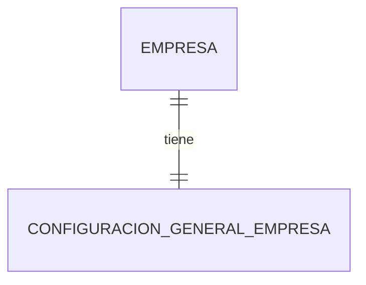

# Empresas — Modelo de datos

## 1. Diagrama

## 2. Entidades

### EMP-ENT-001 — Empresa

- **Estado:** Aprobado
- **Descripción:** representa a la Empresa cliente que contrata y utiliza Tarefero; es la raíz de aislamiento de sus datos, pero no contiene los datos operativos de otros módulos.
- **Identidad:** Identificador UUID v7 generado.

| Atributo | Tipo | Requerido | Restricción | Origen |
|---|---|:---:|---|---|
| `id` | Identificador | Sí | Único; la Empresa no tiene `empresaId` propio | Convenciones; arquitectura §4 |
| `nombre` | Texto | Sí | Hasta 120 caracteres; elimina espacios exteriores; `EMP-BR-001` | `B-04`, `EMP-Q-011` |
| `alias` | Texto | Sí | De 3 a 63 caracteres; único, no reutilizable e inmutable; `EMP-BR-011`, `EMP-BR-012`, `EMP-BR-013` | `EMP-Q-013` |
| `cuit` | Texto | No | Once dígitos sin espacios ni separadores; `EMP-BR-003` | `B-04`, `EMP-Q-004`, `EMP-Q-011` |
| `responsableNombre` | Texto | No | Hasta 120 caracteres; `EMP-BR-010`; sin referencia a Persona ni Cuenta de Empresa | `B-04`, `EMP-Q-003`, `EMP-Q-010`, `EMP-Q-011` |
| `ubicacionTexto` | Texto | No | Hasta 500 caracteres; `EMP-BR-010` | `B-04`, `EMP-Q-011` |
| `ubicacionGeografica` | Punto geográfico | No | `EMP-BR-002` `EMP-Q-005` | `B-04` |
| `descripcionActividad` | Texto | No | Hasta 2000 caracteres; `EMP-BR-010` | `B-04`, `EMP-Q-006`, `EMP-Q-011` |
| `estado` | Enumeración | Sí | `EMP-BR-004`, `EMP-BR-005` | `EMP-Q-002` |
| `creadoEn` | FechaHora | Sí | UTC | Convenciones |
| `creadoPor` | Referencia de actor | Sí | Actor o proceso identificado | Convenciones |
| `actualizadoEn` | FechaHora | Sí | UTC | Convenciones |
| `actualizadoPor` | Referencia de actor | Sí | Actor o proceso identificado | Convenciones |
| `version` | Entero | Sí | Mayor o igual a 1 | Convenciones §3.5 |

**Relaciones**

| Con | Cardinalidad | Requerida | Origen |
|---|---|:---:|---|
| `EMP-ENT-002` | 1 a 1 | Sí | `B-04`, `EMP-Q-007` |

**Estados**

| Desde | Hacia | Por | Regla |
|---|---|---|---|
| No existe | `ACTIVA` | `EMP-UC-001` | `EMP-BR-004` |
| `ACTIVA` | `SUSPENDIDA` | `EMP-UC-005` | `EMP-BR-004` |
| `SUSPENDIDA` | `ACTIVA` | `EMP-UC-006` | `EMP-BR-004` |
| `ACTIVA` | `CERRADA` | `EMP-UC-007` | `EMP-BR-004` |
| `SUSPENDIDA` | `CERRADA` | `EMP-UC-007` | `EMP-BR-004` |

### EMP-ENT-002 — Configuración general de Empresa

- **Estado:** Aprobado
- **Descripción:** contiene únicamente valores transversales necesarios para interpretar fechas e importes de la Empresa; no sustituye configuraciones funcionales de otros módulos.
- **Identidad:** Identificador UUID v7 generado.

| Atributo | Tipo | Requerido | Restricción | Origen |
|---|---|:---:|---|---|
| `id` | Identificador | Sí | Único | Convenciones |
| `empresaId` | Referencia `EMP-ENT-001` | Sí | Único; misma Empresa propietaria | `B-04`, `EMP-Q-007` |
| `paisReferencia` | Código | Sí | ISO 3166-1 alfa-2; `EMP-BR-006` | `EMP-Q-007` |
| `zonaHoraria` | Texto | Sí | Nombre IANA de hasta 255 caracteres; `EMP-BR-006` | Convenciones §2; `EMP-Q-007`, `EMP-Q-011` |
| `monedaPrincipal` | Código | Sí | ISO 4217; `EMP-BR-006` | Convenciones §2; `EMP-Q-007` |
| `creadoEn` | FechaHora | Sí | UTC | Convenciones |
| `creadoPor` | Referencia de actor | Sí | Actor o proceso identificado | Convenciones |
| `actualizadoEn` | FechaHora | Sí | UTC | Convenciones |
| `actualizadoPor` | Referencia de actor | Sí | Actor o proceso identificado | Convenciones |
| `version` | Entero | Sí | Mayor o igual a 1 | Convenciones §3.5 |

**Relaciones**

| Con | Cardinalidad | Requerida | Origen |
|---|---|:---:|---|
| `EMP-ENT-001` | 1 a 1 | Sí | `B-04`, `EMP-Q-007` |

## 3. Datos de otros módulos

| Dato | Módulo dueño | Cómo se usa | Dependencia |
|---|---|---|---|
| Asignación comercial o Suscripción | `SUS` | Se confirma por contrato; no se incorpora dentro de Empresa | `EMP-DEP-002` |

Las Chacras, los Empleados, los Usuarios y las configuraciones funcionales no son relaciones internas de `EMP`; cada módulo conserva su dato y referencia `empresaId` conforme a arquitectura.

## 4. Índices y restricciones necesarias

| Necesidad | Motivo | Migración |
|---|---|---|
| Unicidad de `empresaId` en configuración general | Relación uno a uno de `EMP-ENT-002` | Pendiente de fase 3 |
| Unicidad global de `alias` sin reutilización | `EMP-BR-012`; las Empresas cerradas se conservan por `EMP-BR-008` | Pendiente de fase 3 |
| Resolución estable por `alias` | `EMP-DEP-003`, `EMP-Q-013` | Pendiente de fase 3 |
| Búsqueda estable por estado, nombre e identificador | `EMP-UC-003` y paginación por base de datos | Pendiente de fase 3 |
| Concurrencia optimista por `id` y `version` | Convenciones §3.5 | Pendiente de fase 3 |
