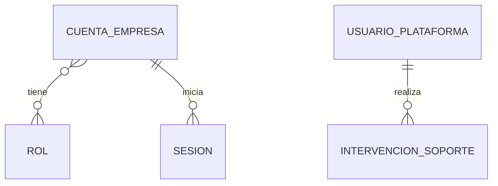

# Identidad y acceso — Modelo de datos

Modelo lógico aprobado del alcance funcional. No define tablas físicas, credenciales en claro ni una identidad global compartida. Los detalles físicos y los contratos técnicos se concretarán durante la planificación sin alterar estas reglas.

## 1. Diagrama

La Empresa y la persona referenciada son externas a ACC; las relaciones con ellas se resuelven por las dependencias del módulo. El mecanismo operativo de acceso y recuperación de plataforma queda a cargo del Ingeniero según `ACC-Q-017`; no se deriva de ello un formulario ni credenciales globales compartidas con Empresas.

## 2. Entidades

Los atributos técnicos comunes siguen convenciones.md §2 y §6.1: identidad, fechas, actor y versión cuando corresponda. No se replican aquí sus definiciones.

### ACC-ENT-001 — Cuenta de Empresa

- **Estado:** Aprobado
- **Descripción:** acceso de una persona dentro de una Empresa, conforme al glosario. El término Usuario no implica una identidad de credenciales globales; se concreta aquí mediante su cuenta independiente según `ACC-Q-001`.
- **Identidad:** identificador según convenciones.md §2.

| Atributo | Tipo | Requerido | Restricción | Origen |
|---|---|:---:|---|---|
| `id` | Identificador | Sí | Convenciones §2 | Convenciones |
| `empresaId` | Referencia externa | Sí | `ACC-BR-001`, `ACC-BR-002`, `ACC-DEP-001` | `B-03`, `ACC-Q-001` |
| `personaId` | Referencia externa | Sí | Contrato de `ACC-DEP-003`; identidad personal no duplicada | `ACC-Q-002`, `ACC-Q-004`; forma técnica a concretar al planificar |
| `correoAcceso` | Texto | Sí | Máximo 254 caracteres luego de eliminar espacios exteriores; se conserva en minúsculas; `ACC-BR-003`, `ACC-BR-004`, `ACC-BR-018` | `B-07`, `B-10`, `ACC-Q-018` |
| `credencial` | Credencial protegida | Sí | La contraseña recibida admite de 15 a 128 caracteres y no se recorta ni cambia de mayúsculas; protección según convenciones.md §7.1 y `ACC-BR-019`; no es un atributo de consulta | `B-07`, `B-08`, `ACC-Q-001`, `ACC-Q-018` |
| `accesoWeb` | Booleano | Sí | `ACC-BR-005`, `ACC-BR-006` | `ACC-Q-010` |
| `accesoMovil` | Booleano | Sí | `ACC-BR-005`, `ACC-BR-006` | `ACC-Q-010` |
| `roles` | Colección de referencias | Sí | `ACC-BR-007`; una o varias asignaciones, según `ACC-Q-016` | `B-02`, `ACC-Q-006`, `ACC-Q-016` |
| `estado` | Enumeración | Sí | `ACTIVA`, `SUSPENDIDA`; `ACC-BR-016` | `ACC-Q-016` |
| `version` | Entero | Sí | Convenciones §3.5 | Convenciones |

La conservación de la cuenta sigue `ACC-BR-017`. No se genera una Cuenta de Empresa para representar solamente una persona sin acceso: esa situación pertenece a `ACC-DEP-003`, según `ACC-Q-004`. No se incorpora un indicador de cambio obligatorio de contraseña: `ACC-BR-012`. La contraseña en claro nunca se persiste ni se expone en consultas.

**Relaciones**

| Con | Cardinalidad | Requerida | Origen |
|---|---|:---:|---|
| Empresa de `ACC-DEP-001` | Muchas cuentas a una Empresa | Sí | `B-01`, `B-03` |
| Persona de `ACC-DEP-003` | Una persona por cuenta; una cuenta como máximo por persona y Empresa, según `ACC-BR-015` | Sí | `ACC-Q-001`, `ACC-Q-004`, `ACC-Q-016` |
| `ACC-ENT-002` | Una o varias asignaciones por cuenta | Sí | `B-02`, `ACC-Q-006`, `ACC-Q-016` |
| `ACC-ENT-003` | Una cuenta a muchas sesiones | No | `B-02`; arquitectura §13 |

**Estados**

| Desde | Hacia | Por | Regla |
|---|---|---|---|
| No existe | `ACTIVA` | `ACC-UC-001` | `ACC-BR-004`, `ACC-BR-006` |
| `ACTIVA` | `SUSPENDIDA` | `ACC-UC-010` | `ACC-BR-016` |
| `SUSPENDIDA` | `ACTIVA` | `ACC-UC-010` | `ACC-BR-006`, `ACC-BR-016` |

### ACC-ENT-002 — Rol

- **Estado:** Aprobado
- **Descripción:** elemento del catálogo fijo del sistema; no es un catálogo editable por Empresa.
- **Identidad:** código canónico del glosario.

| Atributo | Tipo | Requerido | Restricción | Origen |
|---|---|:---:|---|---|
| `codigo` | Enumeración | Sí | `ADMINISTRADOR`, `CAPATAZ`, `EMPLEADO`, `SUPER_ADMINISTRADOR`; `ACC-BR-007` | `ACC-Q-006`; glosario |
| `permisos` | Colección de capacidades | Sí | Cada módulo define su matriz en use-case; no se inventan permisos de negocio aquí | `B-02`, `ACC-Q-006`; reglas-documentacion.md §3 |

El alcance del rol se determina por el glosario y por `ACC-BR-007`. El modelo no permite convertir una cuenta interna en una identidad de plataforma mediante asignación de rol.

### ACC-ENT-003 — Sesión de Empresa

- **Estado:** Aprobado
- **Descripción:** relación de autenticación persistente definida en arquitectura.md §13 y convenciones.md §7.1. La administración detallada de Dispositivo no se incorpora a esta entrega; se conserva la verificación prevista por la fundación.
- **Identidad:** identificador según convenciones.md §2.

| Atributo | Tipo | Requerido | Restricción | Origen |
|---|---|:---:|---|---|
| `id` | Identificador | Sí | Convenciones §2 | Convenciones |
| `cuentaEmpresaId` | Referencia `ACC-ENT-001` | Sí | Contexto según arquitectura §13 | `B-02`, `ACC-Q-001` |
| `canal` | Enumeración | Sí | `WEB` o `MOVIL`; `ACC-BR-005` | `ACC-Q-010` |
| `dispositivoId` | Referencia de dispositivo | Cond. | Forma y obligatoriedad fuera de esta entrega; alcance delimitado en `ACC-Q-017` | Arquitectura §13; `ACC-Q-017` |
| `creadaEn` | FechaHora | Sí | Convenciones §2 | `B-02`; arquitectura §13 |
| `venceEn` | FechaHora | Sí | Convenciones §7.1; distinguir del vencimiento del token de acceso | Convenciones |
| `revocadaEn` | FechaHora | No | Estado actual según arquitectura §13.3 | Convenciones |
| `renovacion` | Credencial protegida y metadatos del ciclo | Cond. | Convenciones §7.1; detalle técnico en planificación | Convenciones |

**Relaciones y ciclo**

Cada Sesión pertenece a una sola `ACC-ENT-001`. `ACC-UC-002` la inicia y `ACC-UC-009` aplica su renovación. La comprobación de vigencia corresponde a `ACC-UC-003`. Los efectos de cambiar o restablecer contraseña referencian `ACC-BR-014`. El cierre voluntario y la administración independiente de revocación no se especifican en esta entrega, según el alcance registrado en `ACC-Q-017`.

### ACC-ENT-004 — Usuario de plataforma con rol SuperAdministrador

- **Estado:** Aprobado
- **Descripción:** identidad de plataforma separada del acceso de las Empresas. Es una concreción de Usuario y del rol SuperAdministrador del glosario; no exige una Empresa ficticia.
- **Identidad:** identificador según convenciones.md §2.

| Atributo | Tipo | Requerido | Restricción | Origen |
|---|---|:---:|---|---|
| `id` | Identificador | Sí | Convenciones §2 | Convenciones |
| `rol` | Referencia `ACC-ENT-002` | Sí | `ACC-BR-007` | `B-05`, `ACC-Q-007` |
| `activo` | Booleano | Sí | `ACC-BR-008` | `ACC-Q-007` |

El Ingeniero gestiona el mecanismo operativo indicado mediante `.env` en `ACC-Q-017`. Este modelo conserva la identidad auditable y la regla `ACC-BR-008`, sin convertir el archivo de configuración en una definición de nuevos campos de negocio. El detalle del mecanismo no se especifica en esta entrega.

### ACC-ENT-005 — Intervención de soporte

- **Estado:** Aprobado
- **Descripción:** contexto lógico de intervención y sus referencias de auditoría; su representación física se decidirá al planificar. No duplica el historial de negocio.
- **Identidad:** identificador según convenciones.md §2.

| Atributo | Tipo | Requerido | Restricción | Origen |
|---|---|:---:|---|---|
| `id` | Identificador | Sí | Convenciones §2 | IA; `ACC-Q-017` |
| `usuarioPlataformaId` | Referencia `ACC-ENT-004` | Sí | `ACC-BR-011` | `ACC-Q-005` |
| `empresaId` | Referencia externa | Sí | `ACC-DEP-001`, `ACC-BR-011` | `B-05`, `ACC-Q-005` |
| `motivo` | Texto | Sí | Contenido no vacío luego de eliminar espacios exteriores; máximo 1000 caracteres; `ACC-BR-011`, `ACC-BR-020` | `ACC-Q-005`, `ACC-Q-018` |
| `sesionId` | Referencia a Sesión de plataforma | Sí | `ACC-Q-017` | `B-02`, `ACC-Q-005`; arquitectura §14 |
| `solicitudId` | Identificador de correlación | Sí | Convenciones §7.4 | Convenciones |
| `ocurridaEn` | FechaHora | Sí | UTC | `ACC-Q-005`; convenciones |

La presentación al cliente referencia `ACC-Q-008` y `ACC-UC-011`; el acceso a la identidad real de plataforma se mantiene separado del directorio de Empresa mediante `ACC-BR-009`.

## 3. Datos de otros módulos

| Dato | Módulo dueño | Cómo se usa | Dependencia |
|---|---|---|---|
| Identidad, alias y estado de Empresa | EMP; alias definido por `EMP-BR-011` a `EMP-BR-013` | Resolución de Empresa y vigencia, sin copiar sus datos administrativos | `ACC-DEP-001` |
| Persona/Empleado y DNI | PER | Identidad personal y pertenencia, sin copiar datos laborales ni médicos | `ACC-DEP-003` |
| Suscripción, vigencia y cupos | SUS | Validación comercial; contrato provisional requerido | `ACC-DEP-002` |

## 4. Índices y restricciones necesarias

| Necesidad | Motivo | Migración |
|---|---|---|
| Unicidad de correo de acceso por Empresa | `ACC-BR-003`, `ACC-BR-018` | Pendiente de planificación |
| Unicidad de persona por Empresa | `ACC-BR-015` | Pendiente de planificación |
| Identificación y consulta de sesiones vigentes por cuenta | `ACC-UC-003`, `ACC-UC-009` | Pendiente de planificación |
| Consulta paginada de cuentas por Empresa | `ACC-UC-008` | Pendiente de planificación |
| Control concurrente del cupo al habilitar | `ACC-BR-006`; convenciones §3.5 | Pendiente de planificación |
| Control concurrente del último SuperAdministrador | `ACC-BR-008` | Pendiente de planificación |
| Historial de intervenciones por Empresa y fecha | `ACC-UC-011` | Pendiente de planificación |

## 5. Límites de definición

Las dieciocho preguntas quedaron resueltas: diecisiete fueron respondidas y una descartada. Los límites y la normalización de credenciales y del motivo de soporte están definidos por `ACC-BR-018` a `ACC-BR-020`. Los contratos técnicos con otros módulos se concretarán durante la planificación respetando `ACC-DEP-001` a `ACC-DEP-004`. La administración independiente de dispositivos, el cierre voluntario de sesiones y las demás capacidades delimitadas por `ACC-Q-017` permanecen fuera de esta entrega.

