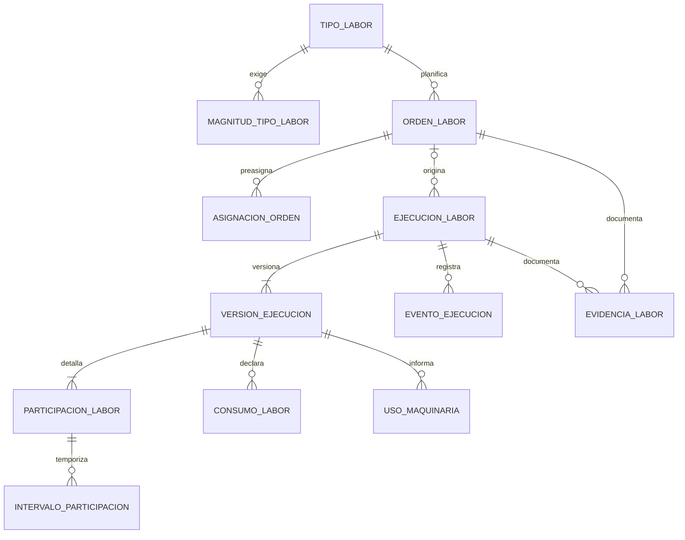

# Labores — Modelo de datos

## 1. Diagrama

Todas las entidades contienen `empresaId` y respetan `LAB-BR-001`. Los Tipos de Labor pertenecen a la Empresa; las Órdenes, ejecuciones y sus hechos también contienen `campaniaId` directamente o por su agregado inmutable conforme a `LAB-BR-004`.

## 2. Entidades

### LAB-ENT-001 — Tipo de Labor

- **Estado:** Aprobado
- **Descripción:** trabajo configurable y reutilizable que una Empresa puede planificar o ejecutar.
- **Identidad:** Identificador generado y código legible inmutable.

| Atributo | Tipo | Requerido | Restricción | Origen |
|---|---|:---:|---|---|
| `id` | Identificador | Sí | Único | Convenciones |
| `empresaId` | Referencia externa | Sí | `LAB-BR-001`, `LAB-DEP-001` | `B-01` |
| `codigo` | Texto | Sí | Hasta 50; único por Empresa; inmutable | `LAB-Q-017` |
| `nombre` | Texto | Sí | Hasta 150; único por Empresa | `B-01`, `LAB-Q-017` |
| `descripcion` | Texto | No | Hasta 1000 | `LAB-Q-017` |
| `contextosRequeridos` | Conjunto controlado | Sí | Puede incluir CHACRA, LOTE, IMPLANTACION, CICLO o UBICACION_OPERATIVA; Campaña siempre se exige por `LAB-BR-004` | `LAB-Q-018` |
| `estado` | Enumeración | Sí | ACTIVO, INACTIVO | `LAB-Q-017` |

**Relaciones**

| Con | Cardinalidad | Requerida | Origen |
|---|---|:---:|---|
| `LAB-ENT-002` | Uno a muchos | No | `LAB-Q-018` |
| `LAB-ENT-003` | Uno a muchos | No | `B-01`, `LAB-Q-002` |

**Estados**

| Desde | Hacia | Por | Regla |
|---|---|---|---|
| — | ACTIVO | `LAB-UC-001` | `LAB-BR-002` |
| ACTIVO | INACTIVO | `LAB-UC-001` | `LAB-BR-002`, `LAB-BR-003` |
| INACTIVO | ACTIVO | `LAB-UC-001` | `LAB-BR-002` |

### LAB-ENT-002 — Magnitud de Tipo de Labor

- **Estado:** Aprobado
- **Descripción:** medida que el Tipo de Labor exige o admite para describir el trabajo real.
- **Identidad:** Identificador generado.

| Atributo | Tipo | Requerido | Restricción | Origen |
|---|---|:---:|---|---|
| `id` | Identificador | Sí | Único | Convenciones |
| `empresaId` | Referencia externa | Sí | `LAB-BR-001` | `B-01` |
| `tipoLaborId` | Referencia `LAB-ENT-001` | Sí | Misma Empresa | `LAB-Q-018` |
| `magnitud` | Enumeración | Sí | TIEMPO, SUPERFICIE, CANTIDAD | `B-01`, `B-03`, `LAB-Q-018` |
| `unidadId` | Referencia externa | Cond. | Unidad compatible provista por `LAB-DEP-005`; no aplica a los intervalos temporales | `B-01`, `LAB-Q-018` |
| `requeridaParaConfirmar` | Booleano | Sí | Aplica `LAB-BR-019` | `LAB-Q-018` |
| `permiteAtribucionIndividual` | Booleano | Sí | Habilita cantidad por participante | `B-03`, `LAB-Q-010` |

### LAB-ENT-003 — Orden de Labor

- **Estado:** Aprobado
- **Descripción:** planificación de un trabajo que puede cumplirse mediante una o varias ejecuciones reales.
- **Identidad:** Identificador generado.

| Atributo | Tipo | Requerido | Restricción | Origen |
|---|---|:---:|---|---|
| `id` | Identificador | Sí | Único | Convenciones |
| `empresaId` | Referencia externa | Sí | `LAB-BR-001` | `B-01` |
| `campaniaId` | Referencia `LAB-DEP-002` | Sí | Inmutable; misma Empresa; Campaña admite el hecho | `B-04`, `LAB-Q-003` |
| `tipoLaborId` | Referencia `LAB-ENT-001` | Sí | Tipo ACTIVO al planificar; misma Empresa | `B-01` |
| `chacraId` | Referencia `LAB-DEP-003` | Cond. | Según el Tipo; misma Empresa | `LAB-Q-018` |
| `loteId` | Referencia `LAB-DEP-003` | Cond. | Según el Tipo; compatible con Chacra | `B-01`, `LAB-Q-018` |
| `implantacionId` | Referencia `LAB-DEP-002` | Cond. | Según el Tipo; compatible con Campaña y Lote | `LAB-Q-018` |
| `cicloId` | Referencia `LAB-DEP-002` | Cond. | Según el Tipo; compatible con Campaña | `LAB-Q-018` |
| `ubicacionOperativa` | Texto | Cond. | Hasta 500; requerida cuando el Tipo exige describir una instalación, calle, alambrado, cerco u otro punto sin catálogo canónico | `B-01`, `LAB-Q-018` |
| `inicioPrevisto` | FechaHora | Sí | — | `B-01` |
| `finPrevisto` | FechaHora | No | No anterior al inicio | `B-01`; propuesta aprobada en `B-05` |
| `alcancePrevisto` | Decimal | No | Positivo y en una magnitud admitida | `B-01`, `LAB-Q-018` |
| `unidadAlcanceId` | Referencia externa | Cond. | Requerida si existe alcance cuantificado | `LAB-Q-018` |
| `notas` | Texto | No | Hasta 4000 | `B-02` |
| `estado` | Enumeración | Sí | BORRADOR, PLANIFICADA, EN_EJECUCION, COMPLETADA, CANCELADA | `LAB-Q-006` |
| `motivoCancelacion` | Texto | Cond. | Hasta 1000; requerido al cancelar | `B-01`, `LAB-Q-006` |
| `creadaEn` | FechaHora | Sí | Inmutable | `LAB-Q-021` |
| `creadaPorCuentaId` | Referencia `LAB-DEP-008` | Sí | Administrador o Capataz autorizado | `LAB-Q-021` |

**Relaciones**

| Con | Cardinalidad | Requerida | Origen |
|---|---|:---:|---|
| `LAB-ENT-004` | Uno a muchos | No | `B-01`, `LAB-Q-008` |
| `LAB-ENT-005` | Uno a muchos | No | `LAB-Q-005` |
| `LAB-ENT-011` | Uno a muchos | No | `B-02`, `LAB-Q-015` |

**Estados**

| Desde | Hacia | Por | Regla |
|---|---|---|---|
| — | BORRADOR | `LAB-UC-003` | `LAB-BR-009` |
| BORRADOR | PLANIFICADA | `LAB-UC-003` | `LAB-BR-009` |
| PLANIFICADA | EN_EJECUCION | `LAB-UC-005` | `LAB-BR-009` |
| EN_EJECUCION | COMPLETADA | `LAB-UC-004` | `LAB-BR-009` |
| BORRADOR, PLANIFICADA o EN_EJECUCION | CANCELADA | `LAB-UC-004` | `LAB-BR-009` |

### LAB-ENT-004 — Asignación de Orden

- **Estado:** Aprobado
- **Descripción:** Empleado o Cuadrilla previstos para una Orden, sin sustituir la participación individual real.
- **Identidad:** Identificador generado.

| Atributo | Tipo | Requerido | Restricción | Origen |
|---|---|:---:|---|---|
| `id` | Identificador | Sí | Único | Convenciones |
| `empresaId` | Referencia externa | Sí | `LAB-BR-001` | `B-01` |
| `ordenLaborId` | Referencia `LAB-ENT-003` | Sí | Misma Empresa y Campaña | `B-01` |
| `empleadoId` | Referencia `LAB-DEP-004` | Cond. | Exactamente uno entre Empleado y Cuadrilla | `B-01`, `LAB-Q-008` |
| `cuadrillaId` | Referencia `LAB-DEP-004` | Cond. | Exactamente uno entre Empleado y Cuadrilla | `B-01`, `LAB-Q-008` |

### LAB-ENT-005 — Ejecución de Labor

- **Estado:** Aprobado
- **Descripción:** identidad estable de un trabajo real, planificado o imprevisto, cuyo detalle puede versionarse.
- **Identidad:** Identificador generado.

| Atributo | Tipo | Requerido | Restricción | Origen |
|---|---|:---:|---|---|
| `id` | Identificador | Sí | Único | Convenciones |
| `empresaId` | Referencia externa | Sí | `LAB-BR-001` | `B-01` |
| `campaniaId` | Referencia `LAB-DEP-002` | Sí | Inmutable; misma Empresa | `B-04`, `LAB-Q-003`, `LAB-Q-016` |
| `tipoLaborId` | Referencia `LAB-ENT-001` | Sí | Inmutable para la ejecución | `B-01`, `LAB-Q-001` |
| `ordenLaborId` | Referencia `LAB-ENT-003` | No | Misma Empresa, Campaña y Tipo | `LAB-Q-004`, `LAB-Q-005` |
| `ejecucionRelacionadaId` | Referencia `LAB-ENT-005` | No | Permite relacionar el trabajo dividido por cambio de Campaña | `LAB-Q-016` |
| `versionVigenteId` | Referencia `LAB-ENT-006` | No | Solo una versión vigente | `LAB-Q-006` |
| `estado` | Enumeración | Sí | BORRADOR, EN_CURSO, PAUSADA, FINALIZADA, CONFIRMADA, CANCELADA, ANULADA | `B-01`, `LAB-Q-006`, `LAB-Q-014` |
| `creadaEn` | FechaHora | Sí | Inmutable | Trazabilidad de `B-02`; propuesta aprobada en `B-05` |
| `creadaPorCuentaId` | Referencia `LAB-DEP-008` | Sí | Administrador o Capataz autorizado | `LAB-Q-007`, `LAB-Q-021` |

**Relaciones**

| Con | Cardinalidad | Requerida | Origen |
|---|---|:---:|---|
| `LAB-ENT-006` | Uno a muchos | Sí | `LAB-BR-025` |
| `LAB-ENT-007` | Uno a muchos | No | `B-01`, `B-02` |
| `LAB-ENT-011` | Uno a muchos | No | `B-02`, `LAB-Q-015` |

**Estados**

| Desde | Hacia | Por | Regla |
|---|---|---|---|
| — | BORRADOR o EN_CURSO | `LAB-UC-005` | `LAB-BR-008`, `LAB-BR-010` |
| BORRADOR | EN_CURSO | `LAB-UC-005` | `LAB-BR-010` |
| EN_CURSO | PAUSADA | `LAB-UC-008` | `LAB-BR-010` |
| PAUSADA | EN_CURSO | `LAB-UC-008` | `LAB-BR-010` |
| EN_CURSO o PAUSADA | FINALIZADA | `LAB-UC-008` | `LAB-BR-010`, `LAB-BR-019`, `LAB-BR-024` |
| FINALIZADA | CONFIRMADA | `LAB-UC-009` | `LAB-BR-024` |
| BORRADOR, EN_CURSO o PAUSADA | CANCELADA | `LAB-UC-008` | `LAB-BR-011` |
| CONFIRMADA | ANULADA | `LAB-UC-010` | `LAB-BR-025` |

### LAB-ENT-006 — Versión de Ejecución

- **Estado:** Aprobado
- **Descripción:** fotografía inmutable de los datos confirmados o versión en preparación para una ejecución.
- **Identidad:** Identificador generado y número secuencial dentro de la ejecución.

| Atributo | Tipo | Requerido | Restricción | Origen |
|---|---|:---:|---|---|
| `id` | Identificador | Sí | Único | Convenciones |
| `empresaId` | Referencia externa | Sí | `LAB-BR-001` | `B-01` |
| `ejecucionLaborId` | Referencia `LAB-ENT-005` | Sí | Misma Empresa | `LAB-BR-025` |
| `numero` | Entero | Sí | Positivo; único y creciente por ejecución | `LAB-BR-025` |
| `versionAnteriorId` | Referencia `LAB-ENT-006` | No | Misma ejecución | `LAB-BR-025` |
| `estadoVersion` | Enumeración | Sí | EN_PREPARACION, CONFIRMADA, SUSTITUIDA, ANULADA | `LAB-BR-025` |
| `chacraId` | Referencia `LAB-DEP-003` | Cond. | Según el Tipo | `LAB-Q-018` |
| `loteId` | Referencia `LAB-DEP-003` | Cond. | Según el Tipo; compatible con Chacra | `B-01`, `LAB-Q-018` |
| `implantacionId` | Referencia `LAB-DEP-002` | Cond. | Según el Tipo y compatible | `LAB-Q-018` |
| `cicloId` | Referencia `LAB-DEP-002` | Cond. | Según el Tipo y compatible | `LAB-Q-018` |
| `ubicacionOperativa` | Texto | Cond. | Hasta 500; según el Tipo; no crea un activo maestro | `LAB-Q-018` |
| `inicioReal` | FechaHora | No | Anterior o igual al fin real | `B-01`, `LAB-Q-006` |
| `finReal` | FechaHora | No | Obligatorio para finalizar | `B-01`, `LAB-Q-006` |
| `superficieRealHa` | Decimal | Cond. | Positiva cuando se exige; no modifica TER | `LAB-BR-020` |
| `cantidadReal` | Decimal | Cond. | No negativa; requerida según el Tipo | `B-01`, `LAB-Q-018` |
| `unidadCantidadId` | Referencia externa | Cond. | Compatible con `LAB-ENT-002` | `LAB-Q-018`, `LAB-DEP-005` |
| `notas` | Texto | No | Hasta 4000 | `B-02` |
| `cosechaId` | Referencia `LAB-DEP-007` | No | Vincula trabajo y producción sin duplicarla | `LAB-Q-019` |
| `motivoCambio` | Texto | Cond. | Requerido si no es la primera versión | `LAB-BR-025` |
| `confirmadaEn` | FechaHora | No | Inmutable después de confirmar | `LAB-BR-024`, `LAB-BR-025` |
| `confirmadaPorCuentaId` | Referencia `LAB-DEP-008` | No | Administrador autorizado | `LAB-Q-007` |

**Relaciones**

| Con | Cardinalidad | Requerida | Origen |
|---|---|:---:|---|
| `LAB-ENT-008` | Uno a muchos | Sí para confirmar | `LAB-Q-008`, `LAB-BR-012` |
| `LAB-ENT-010` | Uno a muchos | No | `B-02`, `LAB-Q-013` |
| `LAB-ENT-012` | Uno a muchos | No | `B-05`, `LAB-DEP-010` |

**Estados de la versión**

| Desde | Hacia | Por | Regla |
|---|---|---|---|
| — | EN_PREPARACION | `LAB-UC-005` o `LAB-UC-010` | `LAB-BR-025` |
| EN_PREPARACION | CONFIRMADA | `LAB-UC-009` | `LAB-BR-024`, `LAB-BR-025` |
| CONFIRMADA | SUSTITUIDA | `LAB-UC-010` al confirmar su reemplazo | `LAB-BR-025` |
| CONFIRMADA | ANULADA | `LAB-UC-010` | `LAB-BR-025` |

### LAB-ENT-007 — Evento de Ejecución

- **Estado:** Aprobado
- **Descripción:** registro cronológico de creación, pausa, reanudación, finalización, confirmación, cancelación, corrección o anulación.
- **Identidad:** Identificador generado.

| Atributo | Tipo | Requerido | Restricción | Origen |
|---|---|:---:|---|---|
| `id` | Identificador | Sí | Único | Convenciones |
| `empresaId` | Referencia externa | Sí | `LAB-BR-001` | `B-02` |
| `ejecucionLaborId` | Referencia `LAB-ENT-005` | Sí | Misma Empresa | `B-01`, `LAB-Q-006` |
| `tipoEvento` | Enumeración | Sí | CREADA, INICIADA, PAUSADA, REANUDADA, FINALIZADA, CONFIRMADA, CANCELADA, CORREGIDA, ANULADA | `B-01`, `LAB-Q-006` |
| `ocurridoEn` | FechaHora | Sí | Inmutable | Trazabilidad de `B-02`; propuesta aprobada en `B-05` |
| `cuentaId` | Referencia `LAB-DEP-008` | Sí | Administrador o Capataz según la transición | `LAB-Q-007`, `LAB-Q-022` |
| `motivo` | Texto | Cond. | Requerido para cancelación, corrección o anulación | `LAB-Q-006`, `LAB-Q-014` |

### LAB-ENT-008 — Participación de Labor

- **Estado:** Aprobado
- **Descripción:** aporte individual de un Empleado en una versión de ejecución.
- **Identidad:** Identificador generado.

| Atributo | Tipo | Requerido | Restricción | Origen |
|---|---|:---:|---|---|
| `id` | Identificador | Sí | Único | Convenciones |
| `empresaId` | Referencia externa | Sí | `LAB-BR-001` | `B-01` |
| `versionEjecucionId` | Referencia `LAB-ENT-006` | Sí | Misma Empresa | `LAB-Q-008` |
| `empleadoId` | Referencia `LAB-DEP-004` | Sí | Empleado de la Empresa; único por versión | `B-01`, `LAB-Q-008` |
| `minutosAtribuidos` | Entero | No | No negativo; coherente con intervalos | `B-01`, `LAB-Q-010` |
| `cantidadAtribuida` | Decimal | No | No negativa | `B-03`, `LAB-Q-010` |
| `unidadCantidadId` | Referencia externa | Cond. | Requerida con cantidad y compatible con el Tipo | `B-03`, `LAB-Q-010` |
| `porcentajeContribucion` | Decimal | Cond. | Entre 0 y 100; suma 100 % cuando aplica `LAB-BR-016` | `B-03`, `LAB-Q-010` |
| `porcentajeSugerido` | Decimal | Cond. | Reparto inicial igual; no monetario | `LAB-Q-010` |
| `motivoAjusteContribucion` | Texto | Cond. | Requerido si difiere del porcentaje sugerido | `B-03`, `LAB-Q-010` |
| `ajustadoPorCuentaId` | Referencia `LAB-DEP-008` | No | Administrador autorizado | `LAB-Q-007`, `LAB-Q-010` |

**Relaciones**

| Con | Cardinalidad | Requerida | Origen |
|---|---|:---:|---|
| `LAB-ENT-009` | Uno a muchos | No | `B-01`, `LAB-Q-012` |

### LAB-ENT-009 — Intervalo de Participación

- **Estado:** Aprobado
- **Descripción:** tramo temporal trabajado por un Empleado en una ejecución.
- **Identidad:** Identificador generado.

| Atributo | Tipo | Requerido | Restricción | Origen |
|---|---|:---:|---|---|
| `id` | Identificador | Sí | Único | Convenciones |
| `empresaId` | Referencia externa | Sí | `LAB-BR-001` | `B-01` |
| `participacionLaborId` | Referencia `LAB-ENT-008` | Sí | Misma Empresa | `LAB-Q-012` |
| `inicio` | FechaHora | Sí | Anterior al fin | `B-01`, `LAB-Q-012` |
| `fin` | FechaHora | Sí | Posterior al inicio | `B-01`, `LAB-Q-012` |

### LAB-ENT-010 — Consumo de Labor

- **Estado:** Aprobado
- **Descripción:** línea de Artículo utilizada en una versión de ejecución y resuelta individualmente por INV.
- **Identidad:** Identificador generado.

| Atributo | Tipo | Requerido | Restricción | Origen |
|---|---|:---:|---|---|
| `id` | Identificador | Sí | Único | Convenciones |
| `empresaId` | Referencia externa | Sí | `LAB-BR-001` | `B-02` |
| `versionEjecucionId` | Referencia `LAB-ENT-006` | Sí | Misma Empresa | `B-02`, `LAB-Q-013` |
| `articuloId` | Referencia `LAB-DEP-005` | Sí | Artículo de la Empresa | `B-02` |
| `almacenId` | Referencia `LAB-DEP-005` | Sí | Almacén de origen de la Empresa | `B-02` |
| `partidaId` | Referencia `LAB-DEP-005` | Cond. | Requerida cuando INV lo determine | `LAB-Q-013` |
| `cantidad` | Decimal | Sí | Positiva | `B-02`, `LAB-Q-013` |
| `unidadId` | Referencia `LAB-DEP-005` | Sí | Compatible con el Artículo | `B-02` |
| `estado` | Enumeración | Sí | DECLARADO, CONFIRMADO, RECHAZADO | `LAB-Q-013` |
| `movimientoInventarioId` | Referencia `LAB-DEP-005` | No | Solo si INV confirma la salida | `LAB-Q-013` |
| `motivoRechazo` | Texto | Cond. | Informado por INV al rechazar | `LAB-Q-013` |

**Estados**

| Desde | Hacia | Por | Regla |
|---|---|---|---|
| — | DECLARADO | `LAB-UC-007` | `LAB-BR-021` |
| DECLARADO | CONFIRMADO | INV mediante `LAB-UC-007` | `LAB-BR-022` |
| DECLARADO | RECHAZADO | INV mediante `LAB-UC-007` | `LAB-BR-022` |

### LAB-ENT-011 — Evidencia de Labor

- **Estado:** Aprobado
- **Descripción:** referencia a una imagen o informe privado asociado con una Orden o ejecución.
- **Identidad:** Identificador generado.

| Atributo | Tipo | Requerido | Restricción | Origen |
|---|---|:---:|---|---|
| `id` | Identificador | Sí | Único | Convenciones |
| `empresaId` | Referencia externa | Sí | `LAB-BR-001` | `B-02` |
| `ordenLaborId` | Referencia `LAB-ENT-003` | Cond. | Exactamente uno entre Orden y ejecución | `B-02`, `LAB-Q-015` |
| `ejecucionLaborId` | Referencia `LAB-ENT-005` | Cond. | Exactamente uno entre Orden y ejecución | `B-02`, `LAB-Q-015` |
| `archivoId` | Referencia `LAB-DEP-006` | Sí | Binario privado conservado en ARC | `B-02`, `LAB-Q-015` |
| `tipo` | Enumeración | Sí | IMAGEN, INFORME, OTRO | `B-02` |
| `descripcion` | Texto | No | Hasta 1000 | `B-02` |

### LAB-ENT-012 — Uso de Maquinaria

- **Estado:** Aprobado
- **Descripción:** referencia a un equipo utilizado en una versión de ejecución, activable cuando exista MAQ.
- **Identidad:** Identificador generado.

| Atributo | Tipo | Requerido | Restricción | Origen |
|---|---|:---:|---|---|
| `id` | Identificador | Sí | Único | Convenciones |
| `empresaId` | Referencia externa | Sí | `LAB-BR-001` | `B-05` |
| `versionEjecucionId` | Referencia `LAB-ENT-006` | Sí | Misma Empresa | `B-05`, `LAB-DEP-010` |
| `maquinariaId` | Referencia `LAB-DEP-010` | Sí | Equipo disponible de la Empresa | `B-05`, `LAB-DEP-010` |
| `inicio` | FechaHora | No | Anterior al fin | `B-05` |
| `fin` | FechaHora | No | Posterior al inicio | `B-05` |
| `cantidadUso` | Decimal | No | No negativa | `B-05` |
| `unidadUsoId` | Referencia externa | Cond. | Requerida con cantidad de uso | `B-05` |

## 3. Datos de otros módulos

| Dato | Módulo dueño | Uso en LAB | Dependencia |
|---|---|---|---|
| Empresa | EMP | Aislar todos los agregados y referencias | `LAB-DEP-001` |
| Campaña, Ciclo e Implantación | CUL | Contextualizar Órdenes y ejecuciones | `LAB-DEP-002` |
| Chacra y Lote | TER | Ubicar el trabajo sin modificar territorio | `LAB-DEP-003` |
| Empleado, Cuadrilla, asistencia, modalidad y tarifa | PER | Asignar, registrar participación, comparar tiempo y originar devengos | `LAB-DEP-004` |
| Artículo, Unidad, Almacén, Partida y Movimiento | INV | Declarar y resolver consumos; reutilizar unidades controladas | `LAB-DEP-005` |
| Archivo | ARC | Referenciar imágenes e informes | `LAB-DEP-006` |
| Cosecha | COS | Vincular el trabajo con la producción obtenida | `LAB-DEP-007` |
| Cuenta, rol y permiso | ACC | Autorizar y auditar actores | `LAB-DEP-008` |
| Indicador o vista agregada | REP | Consumir hechos; nunca se almacena como dato LAB | `LAB-DEP-009` |
| Maquinaria | MAQ | Referenciar equipo utilizado cuando el módulo se active | `LAB-DEP-010` |
| Importe sugerido, ajustado y devengado | PER | Solo se consulta o referencia; no se copia en LAB | `LAB-DEP-004`, `LAB-BR-017`, `LAB-BR-018` |

`ubicacionOperativa` describe dónde se intervino cuando no existe un catálogo canónico de ese elemento. No convierte a LAB en dueño de instalaciones, calles, alambrados o cercos ni crea un activo maestro; si el proyecto incorpora ese catálogo, su módulo dueño reemplazará la descripción por una referencia en una fase posterior.

## 4. Índices y restricciones necesarias

| Entidad | Restricción o índice | Motivo | Origen |
|---|---|---|---|
| `LAB-ENT-001` | Único (`empresaId`, `codigo`) | Código único por Empresa | `LAB-BR-002` |
| `LAB-ENT-001` | Único (`empresaId`, nombre normalizado) | Nombre único por Empresa | `LAB-BR-002` |
| `LAB-ENT-002` | Único (`empresaId`, `tipoLaborId`, `magnitud`, `unidadId`) | No duplicar una magnitud configurada | `LAB-BR-019` |
| `LAB-ENT-003` | Índice (`empresaId`, `campaniaId`, `estado`, `inicioPrevisto`) | Consulta y operación de Órdenes | `LAB-REQ-015` |
| `LAB-ENT-005` | Índice (`empresaId`, `campaniaId`, `tipoLaborId`, `estado`) | Historia por Campaña y Tipo | `LAB-BR-027` |
| `LAB-ENT-006` | Único (`empresaId`, `ejecucionLaborId`, `numero`) | Cadena de versiones estable | `LAB-BR-025` |
| `LAB-ENT-006` | Una sola versión vigente por ejecución | Evitar dos fuentes simultáneas | `LAB-BR-025` |
| `LAB-ENT-008` | Único (`empresaId`, `versionEjecucionId`, `empleadoId`) | Un aporte consolidado por Empleado y versión | `LAB-BR-012` |
| `LAB-ENT-008` | Suma de `porcentajeContribucion` igual a 100 % cuando aplica | Distribución completa | `LAB-BR-016` |
| `LAB-ENT-009` | Sin superposición para el mismo Empleado entre versiones vigentes confirmadas | Evitar doble imputación | `LAB-BR-014` |
| `LAB-ENT-010` | Un único `movimientoInventarioId` por consumo confirmado | Evitar duplicar la salida | `LAB-BR-022` |
| `LAB-ENT-011` | Exactamente uno entre `ordenLaborId` y `ejecucionLaborId` | Evidencia con un único dueño funcional | `LAB-BR-023` |

Las referencias `campaniaId` de Órdenes y ejecuciones no se actualizan. Las correcciones se expresan con otra versión y los trabajos que cambian de Campaña se registran como otra ejecución relacionada conforme a `LAB-BR-005` y `LAB-BR-025`.
