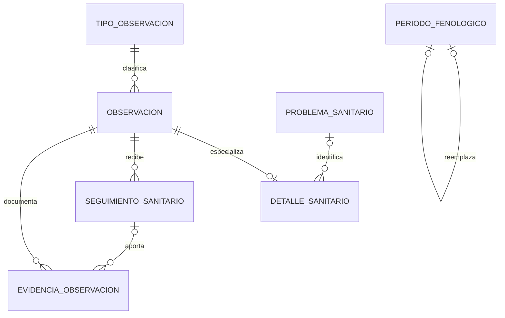

# Observaciones — Modelo de datos

## 1. Diagrama

## 2. Entidades

### OBS-ENT-001 — Período fenológico

- **Estado:** Propuesto
- **Descripción:** intervalo durante el cual una Implantación completa se encuentra registrada en un Estado fenológico.
- **Identidad:** Identificador generado.

| Atributo | Tipo | Requerido | Restricción | Origen |
|---|---|:---:|---|---|
| `id` | Identificador | Sí | Único | Convenciones |
| `empresaId` | Referencia externa | Sí | `OBS-BR-008`, `OBS-DEP-001` | arquitectura multiempresa |
| `implantacionId` | Referencia externa | Sí | `OBS-BR-001`, `OBS-BR-002`, `OBS-DEP-003` | `B-01`, `OBS-Q-002` |
| `estadoFenologicoId` | Referencia externa | Sí | `OBS-BR-002`, `OBS-DEP-003` | `B-01`, `OBS-Q-001` |
| `fechaInicio` | Fecha civil | Sí | `OBS-BR-003` | `B-01` |
| `fechaFin` | Fecha civil | No | Posterior a `fechaInicio`; vacía solo para el vigente; `OBS-BR-001`, `OBS-BR-003` | `B-01` |
| `nota` | Texto | No | Longitud pendiente de planificación | `B-01` |
| `evaluacion` | Enumeración | No | `MUY_MALA`, `MALA`, `ESPERADA`, `BUENA`, `MUY_BUENA`; `OBS-BR-004` | `B-01`, `OBS-Q-004`, `OBS-Q-020` |
| `versionAnteriorId` | Referencia `OBS-ENT-001` | No | Solo para corrección; `OBS-BR-005` | `OBS-Q-003` |
| `motivoCorreccion` | Texto | Cond. | Requerido si existe `versionAnteriorId`; `OBS-BR-005` | `OBS-Q-003` |
| `estadoVersion` | Enumeración | Sí | `VIGENTE`, `FINALIZADA`, `REEMPLAZADA` | `OBS-Q-003` |
| `registradoPorCuentaId` | Referencia externa | Sí | `OBS-DEP-002` | `OBS-Q-016` |
| `registradoEn` | FechaHora | Sí | Auditoría | Convenciones |

**Relaciones**

| Con | Cardinalidad | Requerida | Origen |
|---|---|:---:|---|
| Implantación de `CUL` | Muchos períodos a una Implantación; uno vigente como máximo | Sí | `B-01`, `OBS-Q-001`, `OBS-Q-002` |
| Estado fenológico de `CUL` | Muchos períodos pueden usar un estado compatible | Sí | `OBS-Q-001` |
| `OBS-ENT-001` anterior | Una corrección puede reemplazar una versión | No | `OBS-Q-003` |

**Estados y transiciones**

| Desde | Hacia | Por | Regla |
|---|---|---|---|
| No existe | `VIGENTE` | `OBS-UC-002` | `OBS-BR-001` a `OBS-BR-004` |
| `VIGENTE` | `FINALIZADA` | `OBS-UC-003` | `OBS-BR-003` |
| `VIGENTE` o `FINALIZADA` | `REEMPLAZADA` | `OBS-UC-004` | `OBS-BR-005` |

### OBS-ENT-002 — Tipo de Observación

- **Estado:** Propuesto
- **Descripción:** clasificación configurable que una Empresa cliente utiliza para registrar sus hallazgos.
- **Identidad:** Identificador generado.

| Atributo | Tipo | Requerido | Restricción | Origen |
|---|---|:---:|---|---|
| `id` | Identificador | Sí | Único | Convenciones |
| `empresaId` | Referencia externa | Sí | `OBS-BR-006`, `OBS-DEP-001` | `OBS-Q-005` |
| `nombre` | Texto | Sí | Límite y unicidad pendientes | `B-02` |
| `descripcion` | Texto | No | Límite pendiente | IA |
| `clasificacion` | Enumeración | Sí | `GENERAL`, `SANITARIA` | `OBS-Q-022` |
| `estado` | Enumeración | Sí | `ACTIVO`, `INACTIVO`; `OBS-BR-007` | `OBS-Q-019` |

**Relaciones**

| Con | Cardinalidad | Requerida | Origen |
|---|---|:---:|---|
| `OBS-ENT-003` | Un Tipo puede clasificar muchas Observaciones | No | `B-02` |

**Estados y transiciones**

| Desde | Hacia | Por | Regla |
|---|---|---|---|
| No existe | `ACTIVO` | `OBS-UC-001` | `OBS-BR-006`, `OBS-BR-007` |
| `ACTIVO` | `INACTIVO` | `OBS-UC-001` | `OBS-BR-007` |
| `INACTIVO` | `ACTIVO` | `OBS-UC-001` | `OBS-BR-007` |

### OBS-ENT-003 — Observación

- **Estado:** Propuesto
- **Descripción:** hallazgo puntual general, operativo o sanitario registrado dentro de una Empresa cliente.
- **Identidad:** Identificador generado.

| Atributo | Tipo | Requerido | Restricción | Origen |
|---|---|:---:|---|---|
| `id` | Identificador | Sí | Único | Convenciones |
| `empresaId` | Referencia externa | Sí | `OBS-BR-008`, `OBS-DEP-001` | arquitectura multiempresa |
| `tipoObservacionId` | Referencia `OBS-ENT-002` | Sí | `OBS-BR-006`, `OBS-BR-007` | `B-02` |
| `nota` | Texto | Sí | Límite pendiente | `B-02` |
| `urgencia` | Enumeración | Sí | `BAJA`, `MEDIA`, `ALTA`, `CRITICA`; `OBS-BR-011` | `B-02`, `OBS-Q-007` |
| `observadoEn` | FechaHora | Sí | `OBS-BR-010` | `OBS-Q-021` |
| `chacraId` | Referencia externa | No | `OBS-BR-008`, `OBS-BR-009`, `OBS-DEP-004` | `B-02` |
| `loteId` | Referencia externa | No | `OBS-BR-008`, `OBS-BR-009`, `OBS-DEP-004` | `B-02` |
| `implantacionId` | Referencia externa | No | Condicional para sanitaria; `OBS-BR-009`, `OBS-BR-012`, `OBS-DEP-003` | `B-02`, IA |
| `puntoGeografico` | Punto geográfico | No | `OBS-BR-009` | `B-02`, `OBS-Q-006` |
| `ubicacionDescripcion` | Texto | Cond. | Requerida si no se informa Chacra, Lote, Implantación ni punto geográfico; `OBS-BR-009` | `OBS-Q-015` |
| `periodoFenologicoId` | Referencia `OBS-ENT-001` | No | Resuelto automáticamente por `OBS-BR-010` | `B-02`, `OBS-Q-021` |
| `observadoPorEmpleadoId` | Referencia externa | No | `OBS-DEP-007` | IA, `OBS-Q-016` |
| `registradoPorCuentaId` | Referencia externa | Sí | `OBS-DEP-002` | Convenciones, `OBS-Q-016` |
| `estado` | Enumeración | Sí | `BORRADOR`, `REGISTRADA`, `EN_ATENCION`, `RESUELTA`, `ANULADA`; `OBS-BR-019` | `OBS-Q-017` |
| `versionAnteriorId` | Referencia `OBS-ENT-003` | No | `OBS-BR-024` | EPIC-010, IA |
| `motivoCambio` | Texto | Cond. | Requerido para corrección o anulación; `OBS-BR-024` | EPIC-010, IA |
| `registradoEn` | FechaHora | Sí | Auditoría | Convenciones |
| `actualizadoEn` | FechaHora | Sí | Auditoría | Convenciones |

**Relaciones**

| Con | Cardinalidad | Requerida | Origen |
|---|---|:---:|---|
| `OBS-ENT-002` | Muchas Observaciones a un Tipo | Sí | `B-02` |
| `OBS-ENT-004` | Una Observación tiene como máximo un detalle sanitario | No | `OBS-Q-022` |
| `OBS-ENT-006` | Una Observación puede recibir varios seguimientos | No | `OBS-Q-014` |
| `OBS-ENT-007` | Una Observación puede tener evidencias | No | `B-02`, `OBS-Q-018` |
| Orden de `LAB` | Una Observación puede originar varias Órdenes; la relación la conserva LAB | No | `OBS-Q-008`, `OBS-Q-009` |
| `OBS-ENT-003` anterior | Una corrección puede reemplazar una versión | No | `OBS-BR-024` |

**Estados y transiciones**

| Desde | Hacia | Por | Regla |
|---|---|---|---|
| No existe | `BORRADOR` o `REGISTRADA` | `OBS-UC-006`, `OBS-UC-007` | `OBS-BR-019` |
| `BORRADOR` | `REGISTRADA` | `OBS-UC-006`, `OBS-UC-007` | `OBS-BR-019` |
| `REGISTRADA` | `EN_ATENCION` | `OBS-UC-012` | `OBS-BR-019`, `OBS-BR-021` |
| `REGISTRADA` o `EN_ATENCION` | `RESUELTA` | `OBS-UC-013` | `OBS-BR-019`, `OBS-BR-022` |
| Estado operable | `ANULADA` | `OBS-UC-011` | `OBS-BR-019`, `OBS-BR-024` |

### OBS-ENT-004 — Detalle sanitario

- **Estado:** Propuesto
- **Descripción:** información estructurada de una Observación sanitaria sobre las plantas de una Implantación.
- **Identidad:** la misma Observación asociada.

| Atributo | Tipo | Requerido | Restricción | Origen |
|---|---|:---:|---|---|
| `observacionId` | Referencia `OBS-ENT-003` | Sí | Una a una; `OBS-BR-012` | `OBS-Q-022` |
| `sintoma` | Texto | Sí | Describe lo efectivamente observado; límite pendiente | `OBS-Q-022` |
| `problemaSanitarioId` | Referencia `OBS-ENT-005` | No | `OBS-BR-014` | `OBS-Q-012` |
| `severidad` | Enumeración | No | `LEVE`, `MODERADA`, `GRAVE`, `CRITICA`; `OBS-BR-015` | `OBS-Q-011` |
| `nivelCerteza` | Enumeración | Sí | `SOLO_HALLAZGO`, `CAUSA_SOSPECHADA`, `CAUSA_CONFIRMADA`; `OBS-BR-016` | `OBS-Q-022` |
| `cantidadPlantasAfectadas` | Entero | No | Positivo | IA, `OBS-Q-022` |
| `porcentajeAfectado` | Decimal (porcentaje) | No | Mayor que cero y hasta cien | IA, `OBS-Q-022` |
| `superficieAfectada` | Decimal (hectáreas) | No | Positiva | IA, `OBS-Q-022` |
| `confirmadoPorCuentaId` | Referencia externa | Cond. | Cuenta de Administrador o Capataz; requerida para causa confirmada; `OBS-BR-017` | `OBS-Q-013` |
| `confirmadoEn` | FechaHora | Cond. | Requerido para causa confirmada | `OBS-Q-013` |

**Relaciones**

| Con | Cardinalidad | Requerida | Origen |
|---|---|:---:|---|
| `OBS-ENT-003` | Un detalle pertenece a una Observación sanitaria | Sí | `OBS-Q-022` |
| `OBS-ENT-005` | Un detalle puede identificar un problema aplicable | No | `OBS-Q-012` |

### OBS-ENT-005 — Problema sanitario

- **Estado:** Propuesto
- **Descripción:** causa o problema configurable que una Empresa cliente puede asociar a determinados Cultivos.
- **Identidad:** Identificador generado.

| Atributo | Tipo | Requerido | Restricción | Origen |
|---|---|:---:|---|---|
| `id` | Identificador | Sí | Único | Convenciones |
| `empresaId` | Referencia externa | Sí | `OBS-BR-008` | IA, `OBS-Q-012` |
| `nombre` | Texto | Sí | Límite y unicidad pendientes | IA, `OBS-Q-012` |
| `descripcion` | Texto | No | Límite pendiente | IA, `OBS-Q-012` |
| `cultivoIds` | Colección de referencias externas | Sí | Uno o varios Cultivos de `CUL`; `OBS-BR-014` | `OBS-Q-012` |
| `estado` | Enumeración | Sí | `ACTIVO`, `INACTIVO`; `OBS-BR-007` | `OBS-Q-019` |

**Relaciones**

| Con | Cardinalidad | Requerida | Origen |
|---|---|:---:|---|
| Cultivo de `CUL` | Un problema puede aplicarse a uno o varios Cultivos | Sí | `OBS-Q-012` |
| `OBS-ENT-004` | Un problema puede aparecer en varios detalles | No | `OBS-Q-012` |

### OBS-ENT-006 — Seguimiento sanitario

- **Estado:** Propuesto
- **Descripción:** evaluación posterior vinculada a una Observación sanitaria sin sustituir su hallazgo original.
- **Identidad:** Identificador generado.

| Atributo | Tipo | Requerido | Restricción | Origen |
|---|---|:---:|---|---|
| `id` | Identificador | Sí | Único | Convenciones |
| `empresaId` | Referencia externa | Sí | `OBS-BR-008` | IA, `OBS-Q-014` |
| `observacionId` | Referencia `OBS-ENT-003` | Sí | Debe ser sanitaria; `OBS-BR-018` | IA, `OBS-Q-014` |
| `observadoEn` | FechaHora | Sí | No anterior al hallazgo original | IA, `OBS-Q-014` |
| `evolucion` | Texto | Sí | Límite pendiente | IA, `OBS-Q-014` |
| `severidad` | Enumeración | No | `OBS-BR-015` | `OBS-Q-014` |
| `nivelCerteza` | Enumeración | Sí | `OBS-BR-016` | `OBS-Q-014` |
| `registradoPorCuentaId` | Referencia externa | Sí | `OBS-DEP-002` | IA, `OBS-Q-014` |
| `registradoEn` | FechaHora | Sí | Auditoría | Convenciones |

**Relaciones**

| Con | Cardinalidad | Requerida | Origen |
|---|---|:---:|---|
| `OBS-ENT-003` | Muchos seguimientos a una Observación sanitaria | Sí | `OBS-Q-014` |
| `OBS-ENT-007` | Un seguimiento puede aportar evidencias | No | `OBS-Q-014`, `OBS-Q-018` |

### OBS-ENT-007 — Evidencia de Observación

- **Estado:** Propuesto
- **Descripción:** vínculo entre una Observación o uno de sus seguimientos y un Archivo privado.
- **Identidad:** Identificador generado.

| Atributo | Tipo | Requerido | Restricción | Origen |
|---|---|:---:|---|---|
| `id` | Identificador | Sí | Único | Convenciones |
| `empresaId` | Referencia externa | Sí | `OBS-BR-008` | arquitectura multiempresa |
| `observacionId` | Referencia `OBS-ENT-003` | Sí | `OBS-BR-013` | `B-02` |
| `seguimientoId` | Referencia `OBS-ENT-006` | No | Si se informa, pertenece a la misma Observación | `OBS-Q-014` |
| `archivoId` | Referencia externa | Sí | Archivo privado de la misma Empresa; `OBS-BR-013`, `OBS-DEP-005` | `B-02` |
| `descripcion` | Texto | No | Pendiente de `OBS-Q-018` | IA, `OBS-Q-018` |
| `vinculadoPorCuentaId` | Referencia externa | Sí | `OBS-DEP-002` | Convenciones |
| `vinculadoEn` | FechaHora | Sí | Auditoría | Convenciones |

**Relaciones**

| Con | Cardinalidad | Requerida | Origen |
|---|---|:---:|---|
| `OBS-ENT-003` | Muchas evidencias a una Observación | Sí | `B-02` |
| `OBS-ENT-006` | Una evidencia puede documentar un seguimiento | No | `OBS-Q-014` |
| Archivo de `ARC` | Una referencia a un Archivo privado | Sí | `B-02`, `OBS-DEP-005` |

## 3. Datos de otros módulos

| Dato | Módulo dueño | Cómo se usa | Dependencia |
|---|---|---|---|
| Empresa cliente | `EMP` | Pertenencia y vigencia | `OBS-DEP-001` |
| Cuenta de Empresa, rol y permiso | `ACC` | Autorización, registro y auditoría del actor | `OBS-DEP-002` |
| Cultivo, Implantación, Perfil y Estado fenológico | `CUL` | Contexto y compatibilidad productiva | `OBS-DEP-003` |
| Chacra, Lote y geometría | `TER` | Contexto territorial opcional y validación | `OBS-DEP-004` |
| Archivo | `ARC` | Evidencia privada referenciada | `OBS-DEP-005` |
| Orden de Labor y su estado | `LAB` | Atención del hallazgo sin copiar la Orden | `OBS-DEP-006` |
| Empleado | `PER` | Persona que realizó materialmente la observación | `OBS-DEP-007` |

## 4. Índices y restricciones necesarias

| Necesidad | Motivo | Migración |
|---|---|---|
| Un período vigente por Implantación | `OBS-BR-001` | Pendiente de planificación |
| Períodos por Implantación y fecha de inicio | `OBS-UC-005` | Pendiente de planificación |
| Tipos activos por Empresa y nombre normalizado | `OBS-BR-006`, `OBS-UC-001`; unicidad pendiente | Pendiente de planificación |
| Observaciones por Empresa, estado, urgencia y momento observado | `OBS-UC-010` | Pendiente de planificación |
| Observaciones por Chacra, Lote e Implantación | `OBS-UC-010` | Pendiente de planificación |
| Búsqueda geográfica por punto | `OBS-UC-010` | Pendiente de planificación |
| Problemas sanitarios por Empresa y Cultivo | `OBS-BR-014`, `OBS-UC-001` | Pendiente de planificación |
| Seguimientos por Observación y fecha | `OBS-UC-009`, `OBS-UC-010` | Pendiente de planificación |
