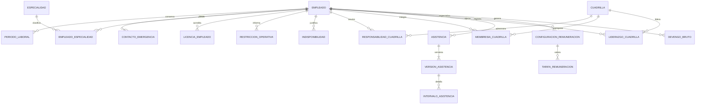

# Personal — Modelo de datos

## 1. Diagrama

Todas las entidades de este modelo contienen `empresaId` conforme a `PER-BR-001`.

## 2. Entidades

### PER-ENT-001 — Empleado

- **Estado:** Aprobado
- **Descripción:** ficha personal y laboral independiente de la Cuenta de Empresa.
- **Identidad:** Identificador generado.

| Atributo | Tipo | Requerido | Restricción | Origen |
|---|---|:---:|---|---|
| `id` | Identificador | Sí | Único | Convenciones |
| `empresaId` | Referencia externa | Sí | `PER-BR-001`, `PER-DEP-001` | `B-05`, `PER-Q-021` |
| `tipoDocumento` | Enumeración | Sí | DNI, PASAPORTE, CEDULA, OTRO | `PER-Q-036`, `PER-Q-039` |
| `detalleTipoDocumento` | Texto | Cond. | Hasta 150; requerido para OTRO | `PER-Q-039` |
| `numeroDocumento` | Texto | Sí | Hasta 50; normalizado; `PER-BR-002` | `B-01`, `PER-Q-036`, `PER-Q-039` |
| `nombre` | Texto | Sí | Hasta 150; no vacío | `B-01`, `PER-Q-039` |
| `apellido` | Texto | Sí | Hasta 150; no vacío | `B-01`, `PER-Q-039` |
| `telefonoContacto` | Texto | Sí | Hasta 30; no único | `B-01`, `PER-Q-039` |
| `fechaNacimiento` | Fecha | No | `PER-BR-004` | `PER-Q-005`, `PER-Q-037` |
| `domicilio` | Texto | No | `PER-BR-004` | `PER-Q-005`, `PER-Q-037` |
| `grupoSanguineo` | Enumeración | No | A, B, AB, O | `PER-Q-005`, `PER-Q-037` |
| `factorSanguineo` | Enumeración | No | POSITIVO, NEGATIVO | `PER-Q-037` |
| `notas` | Texto | No | Hasta 1000 | `PER-Q-005`, `PER-Q-039` |
| `estado` | Enumeración | Sí | ACTIVO, INACTIVO | `PER-Q-007` |

**Relaciones**

| Con | Cardinalidad | Requerida | Origen |
|---|---|:---:|---|
| `PER-ENT-002` | Uno a muchos | Sí | `PER-Q-003`, `PER-Q-007` |
| `PER-ENT-003` | Uno a muchos | No | `PER-Q-005`, `PER-Q-037` |
| `PER-ENT-005` | Uno a muchos | No | `PER-Q-037` |
| `PER-ENT-006` | Uno a muchos | No | `PER-Q-005`, `PER-Q-037` |
| `PER-ENT-007` | Uno a muchos | No | `B-03`, `PER-Q-006` |
| `PER-ENT-008` | Uno a muchos | No | `PER-Q-033` |

**Estados**

| Desde | Hacia | Por | Regla |
|---|---|---|---|
| — | ACTIVO | `PER-UC-001` | `PER-BR-003`, `PER-BR-006` |
| ACTIVO | INACTIVO | `PER-UC-001` | `PER-BR-005`, `PER-BR-008` |
| INACTIVO | ACTIVO | `PER-UC-001` | `PER-BR-005`, `PER-BR-006` |

### PER-ENT-002 — Período laboral

- **Estado:** Aprobado
- **Descripción:** intervalo histórico durante el cual la ficha estuvo vinculada activamente con la Empresa.
- **Identidad:** Identificador generado.

| Atributo | Tipo | Requerido | Restricción | Origen |
|---|---|:---:|---|---|
| `id` | Identificador | Sí | Único | Convenciones |
| `empresaId` | Referencia `PER-DEP-001` | Sí | `PER-BR-001` | `B-05` |
| `empleadoId` | Referencia `PER-ENT-001` | Sí | Misma Empresa | `PER-Q-003` |
| `inicio` | Fecha | Sí | `PER-BR-005` | `PER-Q-003` |
| `fin` | Fecha | No | No anterior al inicio | `PER-Q-003`, `PER-Q-007` |
| `motivoFin` | Texto | Cond. | Hasta 1000; requerido al finalizar | `PER-Q-007`, `PER-Q-039` |

### PER-ENT-003 — Contacto de emergencia

- **Estado:** Aprobado
- **Descripción:** persona de contacto asociada con una ficha laboral.
- **Identidad:** Identificador generado.

| Atributo | Tipo | Requerido | Restricción | Origen |
|---|---|:---:|---|---|
| `id` | Identificador | Sí | Único | Convenciones |
| `empresaId` | Referencia externa | Sí | `PER-BR-001` | `B-05` |
| `empleadoId` | Referencia `PER-ENT-001` | Sí | Misma Empresa | `PER-Q-037` |
| `nombre` | Texto | Sí | Hasta 150 | `PER-Q-037`, `PER-Q-039` |
| `vinculo` | Texto | Sí | Hasta 150 | `PER-Q-037` |
| `telefono` | Texto | Sí | Hasta 30 | `PER-Q-037`, `PER-Q-039` |

### PER-ENT-004 — Especialidad

- **Estado:** Aprobado
- **Descripción:** valor del catálogo de especialidades definido por una Empresa.
- **Identidad:** Identificador generado.

| Atributo | Tipo | Requerido | Restricción | Origen |
|---|---|:---:|---|---|
| `id` | Identificador | Sí | Único | Convenciones |
| `empresaId` | Referencia externa | Sí | `PER-BR-001` | `B-05` |
| `nombre` | Texto | Sí | Hasta 150 | `PER-Q-037`, `PER-Q-039` |
| `descripcion` | Texto | No | Hasta 1000 | `PER-Q-037`, `PER-Q-039` |
| `activa` | Booleano | Sí | No elimina usos históricos | `PER-Q-037`; propuesta aprobada en paquete estructurado |

### PER-ENT-005 — Especialidad de Empleado

- **Estado:** Aprobado
- **Descripción:** vinculación histórica entre un Empleado y una especialidad de su Empresa.
- **Identidad:** Identificador generado.

| Atributo | Tipo | Requerido | Restricción | Origen |
|---|---|:---:|---|---|
| `id` | Identificador | Sí | Único | Convenciones |
| `empresaId` | Referencia externa | Sí | `PER-BR-001` | `B-05` |
| `empleadoId` | Referencia `PER-ENT-001` | Sí | Misma Empresa | `PER-Q-037` |
| `especialidadId` | Referencia `PER-ENT-004` | Sí | Misma Empresa | `PER-Q-037` |
| `inicio` | Fecha | No | — | `PER-Q-037` |
| `fin` | Fecha | No | No anterior al inicio | `PER-Q-037` |

### PER-ENT-006 — Licencia de Empleado

- **Estado:** Aprobado
- **Descripción:** habilitación, matrícula o licencia personal con posible vencimiento y evidencia.
- **Identidad:** Identificador generado.

| Atributo | Tipo | Requerido | Restricción | Origen |
|---|---|:---:|---|---|
| `id` | Identificador | Sí | Único | Convenciones |
| `empresaId` | Referencia externa | Sí | `PER-BR-001` | `B-05` |
| `empleadoId` | Referencia `PER-ENT-001` | Sí | Misma Empresa | `PER-Q-037` |
| `tipo` | Texto | Sí | Hasta 150 | `PER-Q-037` |
| `numero` | Texto | No | Hasta 150 | `PER-Q-037` |
| `emitidaEn` | Fecha | No | — | `PER-Q-037` |
| `venceEn` | Fecha | No | No anterior a emisión | `PER-Q-037` |
| `archivoId` | Referencia externa | No | `PER-DEP-004` | `PER-Q-037` |

### PER-ENT-007 — Restricción operativa

- **Estado:** Aprobado
- **Descripción:** indicación vigente que el Capataz necesita conocer sin acceder a información sensible.
- **Identidad:** Identificador generado.

| Atributo | Tipo | Requerido | Restricción | Origen |
|---|---|:---:|---|---|
| `id` | Identificador | Sí | Único | Convenciones |
| `empresaId` | Referencia externa | Sí | `PER-BR-001` | `B-05` |
| `empleadoId` | Referencia `PER-ENT-001` | Sí | Misma Empresa | `B-03` |
| `tipo` | Texto | Sí | Hasta 150 | `PER-Q-006` |
| `inicio` | Fecha | Sí | `PER-BR-021` | `PER-Q-006` |
| `fin` | Fecha | No | No anterior al inicio | `PER-Q-006` |
| `mensajeOperativo` | Texto | Sí | Hasta 1000; sin diagnóstico | `PER-Q-006`, `PER-Q-039` |
| `anulada` | Booleano | Sí | Conserva historia | `PER-Q-038` |

### PER-ENT-008 — Indisponibilidad

- **Estado:** Aprobado
- **Descripción:** período justificado que impide registrar presencia.
- **Identidad:** Identificador generado.

| Atributo | Tipo | Requerido | Restricción | Origen |
|---|---|:---:|---|---|
| `id` | Identificador | Sí | Único | Convenciones |
| `empresaId` | Referencia externa | Sí | `PER-BR-001` | `B-05` |
| `empleadoId` | Referencia `PER-ENT-001` | Sí | Misma Empresa | `PER-Q-033` |
| `tipo` | Enumeración | Sí | VACACIONES, LICENCIA_MEDICA, LICENCIA_ESPECIAL, SUSPENSION, OTRA_JUSTIFICADA | `PER-Q-033` |
| `inicio` | Fecha | Sí | `PER-BR-022` | `PER-Q-033` |
| `fin` | Fecha | Sí | No anterior al inicio | `PER-Q-033` |
| `mensajeOperativo` | Texto | Sí | Hasta 1000; sin evidencia sensible | `PER-Q-034`, `PER-Q-039` |
| `archivoId` | Referencia externa | No | `PER-DEP-004` | `PER-Q-038` |
| `anuladaEn` | FechaHora | No | Solo Administrador | `PER-Q-038` |
| `motivoAnulacion` | Texto | Cond. | Hasta 1000 | `PER-Q-038`, `PER-Q-039` |

### PER-ENT-009 — Cuadrilla

- **Estado:** Aprobado
- **Descripción:** grupo laboral sin territorio permanente y con identidad propia de la Empresa.
- **Identidad:** Identificador generado y código legible.

| Atributo | Tipo | Requerido | Restricción | Origen |
|---|---|:---:|---|---|
| `id` | Identificador | Sí | Único | Convenciones |
| `empresaId` | Referencia externa | Sí | `PER-BR-001` | `B-05` |
| `codigo` | Texto | Sí | A01–Z99; único por Empresa; inmutable | `B-02`, `B-07`, `PER-Q-009` |
| `nombre` | Texto | Sí | Hasta 150; puede repetirse | `B-02`, `PER-Q-026`, `PER-Q-039` |
| `estado` | Enumeración | Sí | ACTIVA, INACTIVA | `PER-Q-026` |
| `creadorEmpleadoId` | Referencia `PER-ENT-001` | Sí | Debe corresponder al Capataz creador | `PER-Q-011`, `PER-Q-022` |

**Relaciones**

| Con | Cardinalidad | Requerida | Origen |
|---|---|:---:|---|
| `PER-ENT-010` | Uno a muchos | Sí | `PER-Q-022` |
| `PER-ENT-011` | Uno a muchos | No | `B-02`, `PER-Q-027` |
| `PER-ENT-012` | Uno a muchos | No | `B-08`, `PER-Q-010` |

**Estados**

| Desde | Hacia | Por | Regla |
|---|---|---|---|
| — | ACTIVA | `PER-UC-004` | `PER-BR-009`, `PER-BR-010` |
| ACTIVA | INACTIVA | `PER-UC-005` | `PER-BR-010`, `PER-BR-011` |
| INACTIVA | ACTIVA | `PER-UC-005` | `PER-BR-010`, `PER-BR-011` |

### PER-ENT-010 — Responsabilidad de Cuadrilla

- **Estado:** Aprobado
- **Descripción:** período durante el cual un Capataz puede administrar y operar una Cuadrilla.
- **Identidad:** Identificador generado.

| Atributo | Tipo | Requerido | Restricción | Origen |
|---|---|:---:|---|---|
| `id` | Identificador | Sí | Único | Convenciones |
| `empresaId` | Referencia externa | Sí | `PER-BR-001` | `B-05` |
| `cuadrillaId` | Referencia `PER-ENT-009` | Sí | Misma Empresa | `PER-Q-011` |
| `capatazEmpleadoId` | Referencia `PER-ENT-001` | Sí | Empleado activo con rol Capataz en ACC | `PER-Q-011`, `PER-Q-022` |
| `inicio` | FechaHora | Sí | Una responsabilidad vigente por Cuadrilla | `PER-Q-022` |
| `fin` | FechaHora | No | No anterior al inicio | `PER-Q-022` |
| `asignadaPorCuentaId` | Referencia externa | Sí | Actor de ACC | `PER-Q-022` |

### PER-ENT-011 — Membresía de Cuadrilla

- **Estado:** Aprobado
- **Descripción:** período durante el cual un Empleado integra una Cuadrilla.
- **Identidad:** Identificador generado.

| Atributo | Tipo | Requerido | Restricción | Origen |
|---|---|:---:|---|---|
| `id` | Identificador | Sí | Único | Convenciones |
| `empresaId` | Referencia externa | Sí | `PER-BR-001` | `B-05` |
| `cuadrillaId` | Referencia `PER-ENT-009` | Sí | Misma Empresa | `B-02` |
| `empleadoId` | Referencia `PER-ENT-001` | Sí | ACTIVO y misma Empresa | `B-02`, `PER-Q-008`, `PER-Q-027` |
| `inicio` | Fecha | Sí | `PER-BR-014` | `PER-Q-027` |
| `fin` | Fecha | No | No anterior al inicio | `PER-Q-027` |

### PER-ENT-012 — Liderazgo de Cuadrilla

- **Estado:** Aprobado
- **Descripción:** período opcional durante el cual un integrante actúa como líder sin recibir acceso por ese hecho.
- **Identidad:** Identificador generado.

| Atributo | Tipo | Requerido | Restricción | Origen |
|---|---|:---:|---|---|
| `id` | Identificador | Sí | Único | Convenciones |
| `empresaId` | Referencia externa | Sí | `PER-BR-001` | `B-05` |
| `cuadrillaId` | Referencia `PER-ENT-009` | Sí | Misma Empresa | `B-08` |
| `empleadoId` | Referencia `PER-ENT-001` | Sí | Membresía vigente | `PER-Q-010`, `PER-Q-027` |
| `inicio` | Fecha | Sí | Un líder vigente por Cuadrilla | `PER-Q-010` |
| `fin` | Fecha | No | Finaliza al salir de la Cuadrilla | `PER-Q-027` |

### PER-ENT-013 — Asistencia

- **Estado:** Aprobado
- **Descripción:** registro único de un Empleado para una fecha local de su Empresa.
- **Identidad:** Identificador generado.

| Atributo | Tipo | Requerido | Restricción | Origen |
|---|---|:---:|---|---|
| `id` | Identificador | Sí | Único | Convenciones |
| `empresaId` | Referencia externa | Sí | `PER-BR-001` | `B-05` |
| `empleadoId` | Referencia `PER-ENT-001` | Sí | ACTIVO y misma Empresa | `B-03`, `PER-Q-028` |
| `fecha` | Fecha | Sí | Única por Empresa y Empleado; no futura al confirmar | `PER-Q-024`, `PER-Q-039` |
| `capatazResponsableEmpleadoId` | Referencia `PER-ENT-001` | Sí | Primer Capataz autorizado | `PER-Q-024` |
| `estado` | Enumeración | Sí | BORRADOR, CONFIRMADA | `PER-Q-015` |
| `versionActual` | Entero | Sí | Positivo | `PER-Q-015` |

**Estados**

| Desde | Hacia | Por | Regla |
|---|---|---|---|
| — | BORRADOR | `PER-UC-008` | `PER-BR-015`, `PER-BR-016` |
| BORRADOR | CONFIRMADA | `PER-UC-008` | `PER-BR-017` a `PER-BR-019` |
| CONFIRMADA | CONFIRMADA | `PER-UC-009` | `PER-BR-020` |

### PER-ENT-014 — Versión de Asistencia

- **Estado:** Aprobado
- **Descripción:** contenido confirmado o corregido de una Asistencia.
- **Identidad:** Identificador generado.

| Atributo | Tipo | Requerido | Restricción | Origen |
|---|---|:---:|---|---|
| `id` | Identificador | Sí | Único | Convenciones |
| `empresaId` | Referencia externa | Sí | `PER-BR-001` | `B-05` |
| `asistenciaId` | Referencia `PER-ENT-013` | Sí | Misma Empresa | `PER-Q-015` |
| `numero` | Entero | Sí | Positivo y secuencial | `PER-Q-015` |
| `resultado` | Enumeración | Sí | PRESENTE, AUSENTE, AUSENCIA_JUSTIFICADA | `PER-Q-012`, `PER-Q-033` |
| `indisponibilidadId` | Referencia `PER-ENT-008` | Cond. | Requerida para ausencia justificada automática | `PER-Q-033` |
| `confirmadaEn` | FechaHora | Sí | Inmutable | `PER-Q-015` |
| `confirmadaPorCuentaId` | Referencia externa | Sí | Actor de ACC | `PER-Q-015` |
| `motivoCorreccion` | Texto | Cond. | Requerido desde versión 2; hasta 1000 | `PER-Q-015`, `PER-Q-039` |

### PER-ENT-015 — Intervalo de Asistencia

- **Estado:** Aprobado
- **Descripción:** tramo horario opcional de una versión de Asistencia.
- **Identidad:** Identificador generado.

| Atributo | Tipo | Requerido | Restricción | Origen |
|---|---|:---:|---|---|
| `id` | Identificador | Sí | Único | Convenciones |
| `empresaId` | Referencia externa | Sí | `PER-BR-001` | `B-05` |
| `versionAsistenciaId` | Referencia `PER-ENT-014` | Sí | Misma Empresa | `B-03`, `PER-Q-013` |
| `ingreso` | Hora | Sí | Precisión de minuto | `B-03`, `PER-Q-039` |
| `egreso` | Hora | Cond. | Requerido para confirmar POR_HORA | `PER-Q-013`, `PER-Q-030` |
| `notaIngreso` | Texto | No | Hasta 1000 | `B-03`, `PER-Q-014`, `PER-Q-039` |
| `notaEgreso` | Texto | No | Hasta 1000 | `B-03`, `PER-Q-014`, `PER-Q-039` |

### PER-ENT-016 — Configuración de remuneración

- **Estado:** Aprobado
- **Descripción:** modalidad vigente general de Empresa o excepción para un Empleado.
- **Identidad:** Identificador generado.

| Atributo | Tipo | Requerido | Restricción | Origen |
|---|---|:---:|---|---|
| `id` | Identificador | Sí | Único | Convenciones |
| `empresaId` | Referencia externa | Sí | `PER-BR-001` | `B-05` |
| `empleadoId` | Referencia `PER-ENT-001` | No | Ausente para configuración general | `B-04`, `PER-Q-017` |
| `modalidad` | Enumeración | Sí | `PER-BR-023` | `PER-Q-016` |
| `inicio` | Fecha | Sí | `PER-BR-025` | `PER-Q-018` |
| `fin` | Fecha | No | No anterior al inicio | `PER-Q-018` |
| `importeBase` | Dinero | Cond. | Requerido según modalidad | `PER-Q-031` |

### PER-ENT-017 — Tarifa de remuneración

- **Estado:** Aprobado
- **Descripción:** valor vigente de remuneración conservado por PER, que puede referenciar una Labor o una unidad productiva definida por su módulo dueño.
- **Identidad:** Identificador generado.

| Atributo | Tipo | Requerido | Restricción | Origen |
|---|---|:---:|---|---|
| `id` | Identificador | Sí | Único | Convenciones |
| `empresaId` | Referencia externa | Sí | `PER-BR-001` | `B-05` |
| `configuracionId` | Referencia `PER-ENT-016` | Sí | Misma Empresa | `PER-Q-017` |
| `importe` | Dinero | Sí | Positivo | `PER-Q-017`, `PER-Q-031` |
| `unidad` | Texto tipado | Cond. | Requerida para POR_LABOR o POR_PRODUCCION | `PER-Q-016` |
| `tipoLaborId` | Referencia externa | No | `PER-BR-027`, `PER-DEP-005` | `B-04`, `PER-Q-032` |
| `inicio` | Fecha | Sí | `PER-BR-025` | `PER-Q-018` |
| `fin` | Fecha | No | No anterior al inicio | `PER-Q-018` |

### PER-ENT-018 — Devengo bruto

- **Estado:** Aprobado
- **Descripción:** resultado bruto calculado para un Empleado y período antes de obligaciones y pagos.
- **Identidad:** Identificador generado.

| Atributo | Tipo | Requerido | Restricción | Origen |
|---|---|:---:|---|---|
| `id` | Identificador | Sí | Único | Convenciones |
| `empresaId` | Referencia externa | Sí | `PER-BR-001` | `B-05` |
| `empleadoId` | Referencia `PER-ENT-001` | Sí | Misma Empresa | `PER-Q-019` |
| `periodoInicio` | Fecha | Sí | No posterior a fin | `PER-Q-019`, `PER-Q-031` |
| `periodoFin` | Fecha | Sí | — | `PER-Q-019`, `PER-Q-031` |
| `modalidadAplicada` | Enumeración | Sí | `PER-BR-023` | `PER-Q-031` |
| `cantidadAplicada` | Decimal | Cond. | Horas, días, Labores o producción atribuidos individualmente | `PER-Q-031`, `PER-Q-040` |
| `valorAplicado` | Dinero | Sí | Fijado por `PER-BR-025` | `PER-Q-018`, `PER-Q-031` |
| `importeBruto` | Dinero | Sí | `PER-BR-026` | `PER-Q-019`, `PER-Q-031` |
| `origenes` | Referencias externas | Sí | Hechos confirmados de PER/LAB/COS | `PER-Q-019` |
| `calculadoEn` | FechaHora | Sí | Inmutable | `PER-Q-019` |

## 3. Datos de otros módulos

| Dato | Módulo dueño | Cómo se usa | Dependencia |
|---|---|---|---|
| Empresa cliente | EMP | Tenant y vigencia | `PER-DEP-001` |
| Límite de Empleados activos | SUS | Validar alta o reactivación | `PER-DEP-002` |
| Cuenta, vínculo opcional por `empleadoId`, roles, permisos y Sesiones | ACC | Autorizar acceso sin duplicar la Cuenta ni el vínculo en PER | `PER-DEP-003` |
| Archivos y evidencias | ARC | Referencias sin copiar binarios | `PER-DEP-004` |
| Labor, ubicación y cantidades | LAB | Hechos para cálculo; ubicación efectiva de Cuadrilla | `PER-DEP-005` |
| Cantidad productiva | COS | Hechos para POR_PRODUCCION | `PER-DEP-006` |
| Obligación y pago | ECO | Recibe el Devengo bruto | `PER-DEP-007` |

## 4. Índices y restricciones necesarias

| Necesidad | Motivo | Migración |
|---|---|---|
| Unicidad de Empresa, tipo y número de documento normalizados | `PER-BR-002` | Pendiente de planificación |
| Búsqueda de Empleados por Empresa, estado, apellido y documento | `PER-UC-001`, `PER-UC-008` | Pendiente de planificación |
| Unicidad de Empresa y código de Cuadrilla | `PER-BR-009` | Pendiente de planificación |
| Una responsabilidad vigente por Cuadrilla | `PER-BR-011` | Pendiente de planificación |
| Membresías sin superposición por Empresa, Cuadrilla y Empleado | `PER-BR-014` | Pendiente de planificación |
| Un liderazgo vigente por Cuadrilla | `PER-BR-014` | Pendiente de planificación |
| Unicidad de Empresa, Empleado y fecha de Asistencia | `PER-BR-016` | Pendiente de planificación |
| Versiones de Asistencia únicas y secuenciales | `PER-BR-020` | Pendiente de planificación |
| Intervalos consultables por versión y sin superposición | `PER-BR-018` | Pendiente de planificación |
| Configuraciones y tarifas por Empresa, alcance y vigencia | `PER-BR-024`, `PER-BR-025`, `PER-BR-027` | Pendiente de planificación |
| Devengos por Empresa, Empleado y período | `PER-UC-012` | Pendiente de planificación |

## 5. Propiedad de tarifas

Conforme a `PER-Q-032`, `PER-ENT-017` pertenece a PER. Las referencias a tipos de Labor o unidades productivas no transfieren a PER la propiedad de los catálogos, hechos ni cantidades de LAB o COS.
