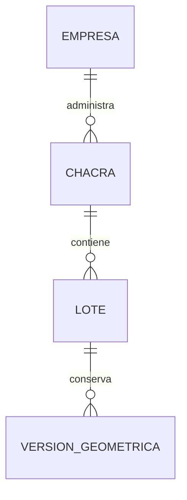

# Territorio — Modelo de datos

Modelo lógico de Territorio. `TER-ENT-001` pertenece a la primera entrega aprobada de Chacras; `TER-ENT-002` y `TER-ENT-003` pertenecen a la segunda entrega aprobada de Lotes y versiones geométricas. Este documento no define tablas físicas.

## 1. Diagrama

Empresa es externa a TER. Una Chacra puede existir sin Lotes según `TER-Q-004`; un Lote pertenece a una sola Chacra según `TER-BR-009`.

## 2. Entidades

### TER-ENT-001 — Chacra

- **Estado:** Aprobado
- **Descripción:** lugar físico de una Empresa cliente, conforme al término Chacra del glosario. Esta entrega conserva su identidad y datos descriptivos; no exige geometría para registrarlo.
- **Identidad:** identificador según convenciones.md §2.

| Atributo | Tipo | Requerido | Restricción | Origen |
|---|---|:---:|---|---|
| `id` | Identificador | Sí | Convenciones §2 | Convenciones |
| `empresaId` | Referencia externa | Sí | `TER-BR-003`, `TER-DEP-001`; contexto según arquitectura §13.4 | `B-01`, `TER-Q-003` |
| `nombre` | Texto | Sí | Hasta 150 caracteres; `TER-BR-001` | `B-01`, `TER-Q-002`, `TER-Q-006` |
| `nombreCorto` | Texto | Sí | Hasta 50 caracteres; `TER-BR-002`, `TER-BR-007` | `B-01`, `TER-Q-002`, `TER-Q-005`, `TER-Q-006`, `TER-Q-007`, `TER-Q-010` |
| `responsableNombre` | Texto | No | Hasta 150 caracteres; sin relación con Usuario, Persona ni Cuenta de Empresa | `B-01`, `TER-Q-002`, `TER-Q-006` |
| `estado` | Enumeración | Sí | Valores `ACTIVA`, `INACTIVA`; `TER-BR-005`, `TER-BR-006` | `TER-Q-006` |
| `creadoEn` | FechaHora | Sí | Convenciones §2 y §6.1 | Convenciones |
| `creadoPor` | Referencia de actor | Sí | Convenciones §6.1; contexto técnico de auditoría según arquitectura §14 | Convenciones |
| `actualizadoEn` | FechaHora | Sí | Convenciones §2 y §6.1 | Convenciones |
| `actualizadoPor` | Referencia de actor | Sí | Convenciones §6.1 | Convenciones |
| `version` | Entero | Sí | Convenciones §3.5 | Convenciones |

La comparación de unicidad ignora mayúsculas, tildes, espacios exteriores y espacios consecutivos según `TER-Q-007`; la forma técnica de normalización se definirá en la planificación sin cambiar ese significado. La longitud máxima fue confirmada en `TER-Q-006`.

**Relaciones**

| Con | Cardinalidad | Requerida | Origen |
|---|---|:---:|---|
| Empresa mediante `TER-DEP-001` | Muchas Chacras a una Empresa | Sí | `B-01`, `TER-BR-003` |
| Lote `TER-ENT-002` | Una Chacra puede contener ninguno o varios Lotes; no se exige uno al registrar la Chacra | No | `B-01`, `TER-Q-004`, `TER-BR-009` |

**Estados y transiciones**

| Desde | Hacia | Por | Regla |
|---|---|---|---|
| No existe | `ACTIVA` | `TER-UC-001` | `TER-BR-005` |
| `ACTIVA` | `INACTIVA` | `TER-UC-005` | `TER-BR-005`, `TER-BR-006` |

La modificación descriptiva de `TER-UC-004` no cambia el estado y también se admite sobre una Chacra INACTIVA según `TER-BR-008`. Una transición de reactivación requiere especificación posterior según `TER-Q-006`.

### TER-ENT-002 — Lote

- **Estado:** Aprobado
- **Descripción:** unidad territorial estable perteneciente a una Chacra. Conserva su identidad, sus datos descriptivos y su ciclo administrativo; los hechos productivos y operativos pertenecen a sus módulos dueños.
- **Identidad:** identificador según convenciones.md §2.

| Atributo | Tipo | Requerido | Restricción | Origen |
|---|---|:---:|---|---|
| `id` | Identificador | Sí | Convenciones §2 | Convenciones |
| `empresaId` | Referencia externa | Sí | Defensa de tenant según arquitectura.md §13.4; `TER-BR-009`, `TER-DEP-001` | `TER-Q-013` |
| `chacraId` | Referencia a `TER-ENT-001` | Sí | Inmutable; `TER-BR-009` | `B-02`, `B-11` |
| `nombre` | Texto | Sí | Hasta 150 caracteres; `TER-BR-010` | `B-02`, `TER-Q-013` |
| `codigo` | Texto | Sí | Hasta 30 caracteres; `TER-BR-011`, `TER-BR-012` | `B-02`, `B-11`, `TER-Q-012`, `TER-Q-013` |
| `descripcion` | Texto | No | Hasta 500 caracteres | `B-02`, `TER-Q-013` |
| `notas` | Texto | No | Hasta 2000 caracteres | `B-02`, `TER-Q-013` |
| `tipoSuelo` | Enumeración | No | `TER-BR-020` | `B-02`, `TER-Q-014` |
| `sistemaRiegoPrincipal` | Enumeración | No | `TER-BR-021` | `B-02`, `TER-Q-014` |
| `estado` | Enumeración | Sí | Valores `ACTIVO`, `INACTIVO`; `TER-BR-017` | `TER-Q-019` |
| `creadoEn` | FechaHora | Sí | Convenciones §2 y §6.1 | Convenciones |
| `creadoPor` | Referencia de actor | Sí | Convenciones §6.1 | Convenciones |
| `actualizadoEn` | FechaHora | Sí | Convenciones §2 y §6.1 | Convenciones |
| `actualizadoPor` | Referencia de actor | Sí | Convenciones §6.1 | Convenciones |
| `version` | Entero | Sí | Convenciones §3.5 | Convenciones |

La condición `SIN_DELIMITAR` o `DELIMITADO` y la superficie cartográfica vigente son datos derivados de `TER-ENT-003`; no se administran como valores independientes. La plantación no es un atributo de Lote: se obtiene mediante `TER-DEP-003`.

**Relaciones**

| Con | Cardinalidad | Requerida | Origen |
|---|---|:---:|---|
| Empresa mediante `TER-DEP-001` | Muchos Lotes a una Empresa | Sí | `TER-BR-009`, arquitectura.md §13.4 |
| Chacra `TER-ENT-001` | Muchos Lotes a una Chacra; no cambia después del alta y un Lote ACTIVO exige Chacra ACTIVA | Sí | `B-02`, `B-11`, `TER-BR-009`, `TER-BR-023` |
| Versión geométrica `TER-ENT-003` | Un Lote puede tener ninguna o varias versiones y como máximo una vigente | No | `B-07`, `TER-BR-016` |
| Implantaciones de `CUL` | Un Lote puede ser contexto de varias implantaciones históricas | No | `TER-DEP-003` |

**Estados y transiciones**

| Desde | Hacia | Por | Regla |
|---|---|---|---|
| No existe | `ACTIVO` | `TER-UC-006` | `TER-BR-017`, `TER-BR-023` |
| `ACTIVO` | `INACTIVO` | `TER-UC-011` | `TER-BR-017`, `TER-BR-019` |
| `INACTIVO` | `ACTIVO` | `TER-UC-012` | `TER-BR-017`, `TER-BR-023` |

Según `TER-Q-021`, un Lote INACTIVO admite correcciones descriptivas y geométricas con los controles correspondientes, pero esas correcciones no cambian su estado ni habilitan operaciones productivas. El estado no se deriva de la geometría.

### TER-ENT-003 — Versión geométrica de Lote

- **Estado:** Aprobado
- **Descripción:** representación inmutable de una delimitación del Lote y de la superficie cartográfica calculada para esa delimitación.
- **Identidad:** identificador según convenciones.md §2.

| Atributo | Tipo | Requerido | Restricción | Origen |
|---|---|:---:|---|---|
| `id` | Identificador | Sí | Convenciones §2 | Convenciones |
| `empresaId` | Referencia externa | Sí | Defensa de tenant según arquitectura.md §13.4 | `TER-Q-017` |
| `loteId` | Referencia a `TER-ENT-002` | Sí | `TER-BR-016` | `B-07`, `TER-Q-016` |
| `geometria` | Geometría Polygon | Sí | GeoJSON de entrada, SRID 4326; `TER-BR-013`, `TER-BR-014` | `B-04`, `B-05`, `TER-Q-017` |
| `superficieHectareas` | Decimal | Sí | Calculado; `TER-BR-015` | `B-09`, `TER-Q-017` |
| `vigenteDesde` | FechaHora | Sí | `TER-BR-016` | `TER-Q-016` |
| `vigenteHasta` | FechaHora | No | Sin valor únicamente para la versión vigente; `TER-BR-016` | `TER-Q-016` |
| `motivo` | Texto | Sí | `TER-BR-016` | `TER-Q-016` |
| `creadoEn` | FechaHora | Sí | Convenciones §2 y §6.1 | Convenciones |
| `creadoPor` | Referencia de actor | Sí | Actor que delimitó o corrigió; convenciones §6.1 | `TER-Q-016` |

Las versiones históricas no se actualizan ni se eliminan. Al crear una nueva versión, la anterior deja de ser vigente sin perder su geometría ni su superficie.

## 3. Datos de otros módulos

| Dato | Módulo dueño | Cómo se usa | Dependencia |
|---|---|---|---|
| Empresa propietaria y su habilitación | EMP | Referencia a `EMP-ENT-001`, validada mediante su contrato; no se copian sus datos administrativos | `TER-DEP-001` |
| Actor, permisos, Sesión, alcance autorizado de Chacras y soporte | ACC | Contexto autorizado según `TER-Q-008`; no se copian cuentas ni se modifica su alcance desde esta entrega | `TER-DEP-002` |
| Implantaciones y cultivos del Lote | CUL | Se consultan o enlazan sin copiarlos; también informan procesos activos | `TER-DEP-003` |
| Labores, cuadrillas, empleados y ejecuciones | LAB | Referencian `loteId`; informan operaciones pendientes | `TER-DEP-004` |
| Observaciones | OBS | Referencian el Lote o su implantación | `TER-DEP-005` |
| Cosechas y producción | COS | Se relacionan mediante la implantación del Lote | `TER-DEP-006` |
| Línea temporal e identificadores legibles | REP | Proyecta hechos de los módulos dueños y usa códigos estables de TER | `TER-DEP-007` |

## 4. Índices y restricciones necesarias

| Necesidad | Motivo | Migración |
|---|---|---|
| Unicidad de nombre corto por Empresa | `TER-BR-007`; incluye Chacras INACTIVAS y aplica la equivalencia aprobada en `TER-Q-007` | Pendiente de planificación |
| Búsqueda paginada dentro de Empresa y alcance autorizado | `TER-UC-003`; filtros e índices concretos se decidirán al planificar | Pendiente de planificación |
| Control concurrente por identidad y versión | `TER-UC-004`, `TER-UC-005`; convenciones §3.5 | Pendiente de planificación |
| Conservación de identidad y referencias históricas | `TER-BR-006` | Pendiente de planificación |
| Unicidad normalizada de código de Lote dentro de Chacra | `TER-BR-011`; incluye Lotes activos e inactivos | Pendiente de planificación |
| Una sola versión geométrica vigente por Lote | `TER-BR-016` | Pendiente de planificación |
| Consulta espacial de geometrías vigentes por Empresa | `TER-BR-014`; el índice espacial concreto se decide al planificar | Pendiente de planificación |
| Prevención concurrente de superposición entre Lotes activos | `TER-BR-014`; debe sostenerse ante operaciones simultáneas | Pendiente de planificación |
| Listado por Empresa, Chacra, estado y condición geométrica | `TER-UC-008` | Pendiente de planificación |
| Control concurrente del Lote por identidad y versión | `TER-UC-009` a `TER-UC-012`; convenciones §3.5 | Pendiente de planificación |

## 5. Alcance pendiente de otras entregas

El alcance autorizado de Chacras del Capataz pertenece a `ACC` según `TER-Q-008` y cubre los Lotes contenidos en esas Chacras según `B-12`; requiere un contrato de `TER-DEP-002` antes de planificar consultas. No se define una entidad de asignación nueva en TER.

La dirección textual y el punto de referencia de Chacra aprobados en `TER-Q-018` no se agregan todavía a `TER-ENT-001`: requieren el cambio controlado de la primera entrega. También requiere cambio controlado aplicar `TER-BR-023` a la transición aprobada de inactivación de Chacra; la restricción ya queda definida para el registro y reactivación de Lotes.
