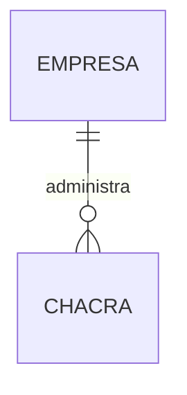

# Territorio — Modelo de datos

Modelo lógico de la entrega de Chacras. Las decisiones de `TER-Q-002` a `TER-Q-006` se incorporan sin extender la entrega a Lotes o convertir estos datos en tablas físicas.

## 1. Diagrama

Empresa es externa a TER. La asociación futura con Lotes no obliga a crear un Lote al registrar la Chacra: referencia `TER-Q-004`.

## 2. Entidades

### TER-ENT-001 — Chacra

- **Estado:** Propuesto
- **Descripción:** lugar físico de una Empresa cliente, conforme al término Chacra del glosario. Esta entrega conserva su identidad y datos descriptivos; no exige geometría para registrarlo.
- **Identidad:** identificador según convenciones.md §2.

| Atributo | Tipo | Requerido | Restricción | Origen |
|---|---|:---:|---|---|
| `id` | Identificador | Sí | Convenciones §2 | Convenciones |
| `empresaId` | Referencia externa | Sí | `TER-BR-003`, `TER-DEP-001`; contexto según arquitectura §13.4 | `B-01`, `TER-Q-003` |
| `nombre` | Texto | Sí | Hasta 150 caracteres; `TER-BR-001` | `B-01`, `TER-Q-002`, `TER-Q-006` |
| `nombreCorto` | Texto | Sí | Hasta 50 caracteres; `TER-BR-002`, `TER-BR-007` | `B-01`, `TER-Q-002`, `TER-Q-005`, `TER-Q-006` |
| `responsableNombre` | Texto | No | Hasta 150 caracteres; sin relación con Usuario, Persona ni Cuenta de Empresa | `B-01`, `TER-Q-002`, `TER-Q-006` |
| `estado` | Enumeración | Sí | Valores `ACTIVA`, `INACTIVA`; `TER-BR-005`, `TER-BR-006` | `TER-Q-006` |
| `creadoEn` | FechaHora | Sí | Convenciones §2 y §6.1 | Convenciones |
| `creadoPor` | Referencia de actor | Sí | Convenciones §6.1; contexto técnico de auditoría según arquitectura §14 | Convenciones |
| `actualizadoEn` | FechaHora | Sí | Convenciones §2 y §6.1 | Convenciones |
| `actualizadoPor` | Referencia de actor | Sí | Convenciones §6.1 | Convenciones |
| `version` | Entero | Sí | Convenciones §3.5 | Convenciones |

La confirmación de unicidad no define por sí sola equivalencias entre mayúsculas, tildes o espacios del nombre corto. Esa normalización debe acordarse al precisar el contrato, antes de planificar su validación; no se supone una política silenciosamente. La longitud máxima ya fue confirmada en `TER-Q-006`.

**Relaciones**

| Con | Cardinalidad | Requerida | Origen |
|---|---|:---:|---|
| Empresa mediante `TER-DEP-001` | Muchas Chacras a una Empresa | Sí | `B-01`, `TER-BR-003` |
| Lotes, entrega posterior dentro de TER | Una Chacra puede comenzar sin Lotes; forma de la relación pendiente de esa especificación | No en esta entrega | `B-01`, `TER-Q-004` |

**Estados y transiciones**

| Desde | Hacia | Por | Regla |
|---|---|---|---|
| No existe | `ACTIVA` | `TER-UC-001` | `TER-BR-005` |
| `ACTIVA` | `INACTIVA` | `TER-UC-005` | `TER-BR-005`, `TER-BR-006` |

La modificación descriptiva de `TER-UC-004` no cambia el estado. Una transición de reactivación requiere especificación posterior según `TER-Q-006`.

## 3. Datos de otros módulos

| Dato | Módulo dueño | Cómo se usa | Dependencia |
|---|---|---|---|
| Empresa propietaria y su habilitación | EMP | Referencia a `EMP-ENT-001`, validada mediante su contrato; no se copian sus datos administrativos | `TER-DEP-001` |
| Actor, permisos, Sesión, alcance de Chacras y soporte | ACC | Contexto autorizado; no se copian cuentas ni se modifica su asignación desde esta entrega | `TER-DEP-002` |

## 4. Índices y restricciones necesarias

| Necesidad | Motivo | Migración |
|---|---|---|
| Unicidad de nombre corto por Empresa | `TER-BR-007`; sin excluir Chacras INACTIVAS. Comparación y normalización por acordar antes del contrato | Pendiente de planificación |
| Búsqueda paginada dentro de Empresa y alcance autorizado | `TER-UC-003`; filtros e índices concretos se decidirán al planificar | Pendiente de planificación |
| Control concurrente por identidad y versión | `TER-UC-004`, `TER-UC-005`; convenciones §3.5 | Pendiente de planificación |
| Conservación de identidad y referencias históricas | `TER-BR-006` | Pendiente de planificación |

## 5. Alcance pendiente de otras entregas

La asignación de Chacras a Capataces requiere un contrato de `TER-DEP-002` acordado antes de planificar consultas con ese alcance. No se define una entidad de asignación nueva en TER por deducción.
