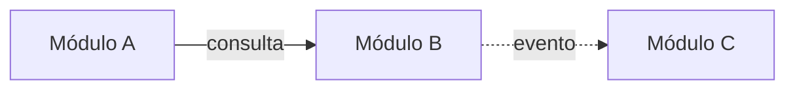

# Arquitectura

<!-- Qué define este archivo: doc/proceso/reglas-documentacion.md §3.
Cada decisión de esta página que no sea obvia tiene un ADR en doc/adr/. Los nombres de carpetas y clases siguen nomenclatura.md. -->

## 1. Stack

| Componente | Elección | ADR |
|---|---|---|
| Lenguaje y versión | [ ] | ADR-NNNN |
| Framework | [ ] | ADR-NNNN |
| Base de datos | [ ] | ADR-NNNN |
| Migraciones | [ ] | |
| Pruebas | [ ] | |
| Pruebas de arquitectura | [ArchUnitTS / dependency-cruiser / import-linter / ArchUnit] | |
| Autenticación | [ ] | ADR-NNNN |

## 2. Estilo

- **Despliegue:** [Monolito modular / servicios por módulo]
- **Interno de cada módulo:** arquitectura hexagonal (puertos y adaptadores)
- **Comunicación entre módulos:** [Llamada a la interfaz pública del módulo / HTTP / eventos]
- **Regla central:** las dependencias apuntan hacia el dominio. El dominio no conoce frameworks, base de datos, HTTP ni otros módulos.

## 3. Módulos

<!-- Registro oficial de módulos y prefijos. Prefijo de 2 a 4 letras, único y permanente. -->

| Prefijo | Módulo | Carpeta | Responsabilidad (una línea) | Datos propios | Estado |
|---|---|---|---|---|---|
| `[PRE]` | [Nombre] | `doc/modulos/[m]/` · `src/modulos/[m]/` | [Responsabilidad] | [Entidades principales] | Propuesto |



## 4. Reglas entre módulos

- Cada dato tiene un solo módulo dueño, el único que lo escribe.
- Un módulo usa otro solo a través de su interfaz pública (`src/modulos/<m>/publico/`) o de su contrato HTTP/evento.
- Prohibido: importar el dominio o la infraestructura de otro módulo, leer o escribir sus tablas, claves foráneas físicas entre módulos.
- Las dependencias entre módulos no forman ciclos.
- [Reglas adicionales]

## 5. Estructura de un módulo en el código

```text
src/modulos/<modulo>/
├── dominio/
│   ├── modelo/            # Entidades, agregados, objetos de valor
│   ├── politicas/         # Reglas que involucran varias entidades
│   ├── eventos/           # Eventos de dominio
│   └── errores/           # Errores de dominio con código estable
├── aplicacion/
│   ├── casos-de-uso/      # Un archivo por caso de uso
│   └── puertos/
│       ├── entrada/       # Interfaces que exponen los casos de uso
│       └── salida/        # Repositorios, publicador de eventos, otros módulos
├── infraestructura/
│   ├── persistencia/      # Implementación de repositorios
│   ├── mensajeria/        # Eventos
│   └── externos/          # Clientes de otros módulos o sistemas
├── entrada/
│   ├── http/              # Controladores según OpenAPI
│   └── eventos/           # Manejadores de eventos recibidos
├── publico/               # Única superficie que otros módulos pueden usar
└── pruebas/
    ├── dominio/
    ├── aplicacion/
    ├── integracion/
    ├── contrato/
    └── aceptacion/
migraciones/<modulo>/
```

## 6. Capas y dependencias permitidas

| Capa | Contiene | Puede usar | No puede usar |
|---|---|---|---|
| `dominio` | Reglas de negocio y estado | Solo `dominio` y la librería estándar | Todo lo demás, frameworks, ORM, otros módulos |
| `aplicacion` | Casos de uso, permisos, transacciones, puertos | `dominio` | `infraestructura`, `entrada`, frameworks web, ORM |
| `infraestructura` | Implementación de puertos de salida | `aplicacion`, `dominio` | `entrada` |
| `entrada` | Traducción HTTP/eventos ↔ casos de uso | Puertos de entrada de `aplicacion` | `dominio` directamente, `infraestructura` |
| `publico` | Lo que otros módulos pueden usar | `aplicacion` | Internos |

## 7. De la especificación al código

| Especificación | Va en | Se prueba con |
|---|---|---|
| Regla de negocio invariante o validación | `dominio/modelo` (entidad u objeto de valor que impide el estado inválido) | Unitaria con la tabla de ejemplos de la regla |
| Regla de cálculo | `dominio/modelo` u `dominio/politicas` | Unitaria con sus ejemplos |
| Regla de transición | Método de la entidad raíz | Unitaria por transición válida e inválida |
| Regla de autorización de dominio | `dominio/politicas` | Unitaria |
| Matriz de permisos | Inicio del caso de uso en `aplicacion` | Prueba de aplicación: permitido y denegado |
| Caso de uso | `aplicacion/casos-de-uso` | Prueba de aplicación con dobles de los puertos |
| Escenario Gherkin | `pruebas/aceptacion` con el mismo tag | Aceptación |
| Entidad | `dominio/modelo` | Unitaria |
| Guardado y lectura | Puerto en `aplicacion/puertos/salida`, implementación en `infraestructura/persistencia` | Integración |
| Índice o restricción | `migraciones/<modulo>` | Integración |
| Operación de API (`operationId`) | `entrada/http`: traduce y delega, sin reglas | Contrato contra OpenAPI |
| Dependencia con otro módulo | Puerto de salida + cliente en `infraestructura/externos` | Integración / contrato |

## 8. Reglas verificadas automáticamente

| Regla | Verificada por |
|---|---|
| `dominio` no depende de otras capas ni frameworks | [Archivo de regla] |
| `aplicacion` no depende de `infraestructura` ni `entrada` | [Archivo de regla] |
| `entrada` no depende de `dominio` ni `infraestructura` | [Archivo de regla] |
| Un módulo solo usa `publico/` de otro | [Archivo de regla] |
| Sin ciclos entre módulos | [Archivo de regla] |

## 9. Reglas revisadas manualmente

- Los controladores no contienen condicionales de negocio.
- Un caso de uso modifica una sola entidad raíz por transacción, salvo ADR.

## 10. Despliegue y seguridad

- **Entornos:** [Desarrollo / Prueba / Producción]
- **Configuración y secretos:** [Mecanismo]
- **CI/CD:** [Pipeline]
- **Autenticación y sesiones:** [Mecanismo, ADR]
- **Autorización:** roles en `glosario.md`; permisos por caso de uso en el `use-case` de cada módulo.

## 11. Módulo de referencia

[Ruta del primer módulo implementado completo, que los agentes usan como modelo.]
