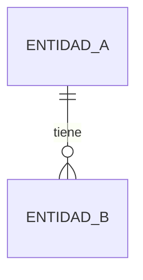

# [Módulo] — Modelo de datos

<!-- Responde: ¿qué datos tiene el módulo, cómo se relacionan y cómo cambian de estado?
Qué define este archivo y qué tiene prohibido: doc/proceso/reglas-documentacion.md §3. Lo que ya está definido en otro archivo se referencia por ID (§5).
Cada atributo tiene origen. Un atributo que el brief no menciona (p. ej. "nombre del lote") tiene origen IA o una pregunta. -->

## 1. Diagrama

## 2. Entidades

### PRE-ENT-001 — [Nombre]

- **Estado:** Propuesto
- **Descripción:** [Qué es, usando el glosario]
- **Identidad:** Identificador generado | [Clave natural]

| Atributo | Tipo | Requerido | Restricción | Origen |
|---|---|:---:|---|---|
| `id` | Identificador | Sí | Único | Convenciones |
| [atributo] | [Texto / Entero / Decimal (unidad) / Fecha / Enumeración / Referencia] | Sí/No | [`PRE-BR-NNN` / formato] | `B-NN` / `PRE-Q-NNN` / IA |

**Relaciones**

| Con | Cardinalidad | Requerida | Origen |
|---|---|:---:|---|
| `PRE-ENT-NNN` | 1 a N | Sí/No | `B-NN` |

**Estados**

<!-- Eliminar si la entidad no tiene ciclo de vida. -->

| Desde | Hacia | Por | Regla |
|---|---|---|---|
| [ESTADO] | [ESTADO] | `PRE-UC-NNN` | `PRE-BR-NNN` |

## 3. Datos de otros módulos

<!-- Solo se guarda el identificador. Nunca se escriben datos de otro módulo. -->

| Dato | Módulo dueño | Cómo se usa | Dependencia |
|---|---|---|---|
| [Empleado] | `OTR` | Referencia por identificador | `PRE-DEP-NNN` |

## 4. Índices y restricciones necesarias

| Necesidad | Motivo | Migración |
|---|---|---|
| [Unicidad / búsqueda frecuente] | `PRE-BR-NNN` / `PRE-UC-NNN` | [Ruta o Pendiente] |
